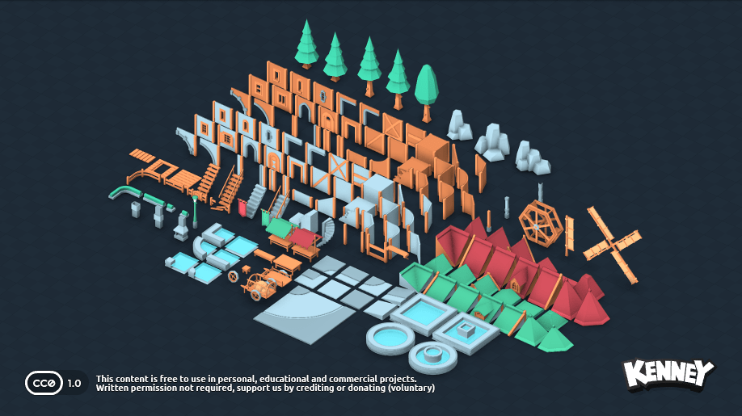
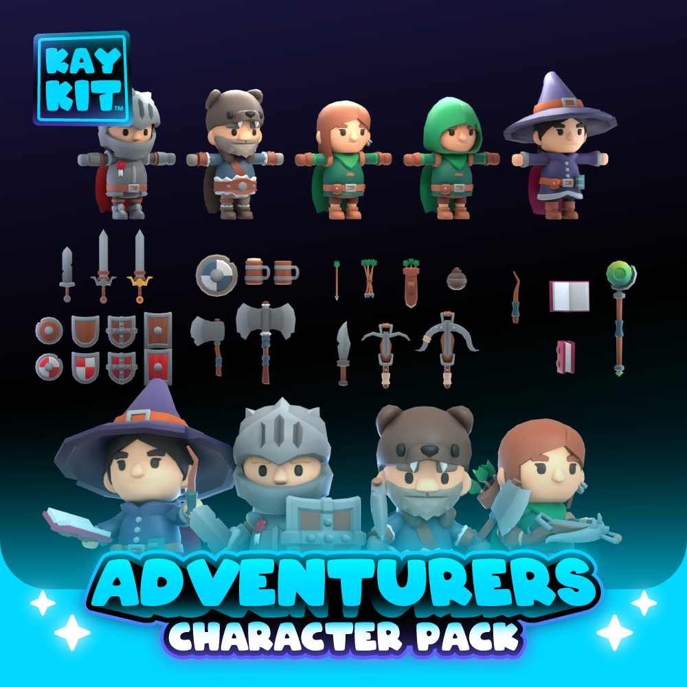
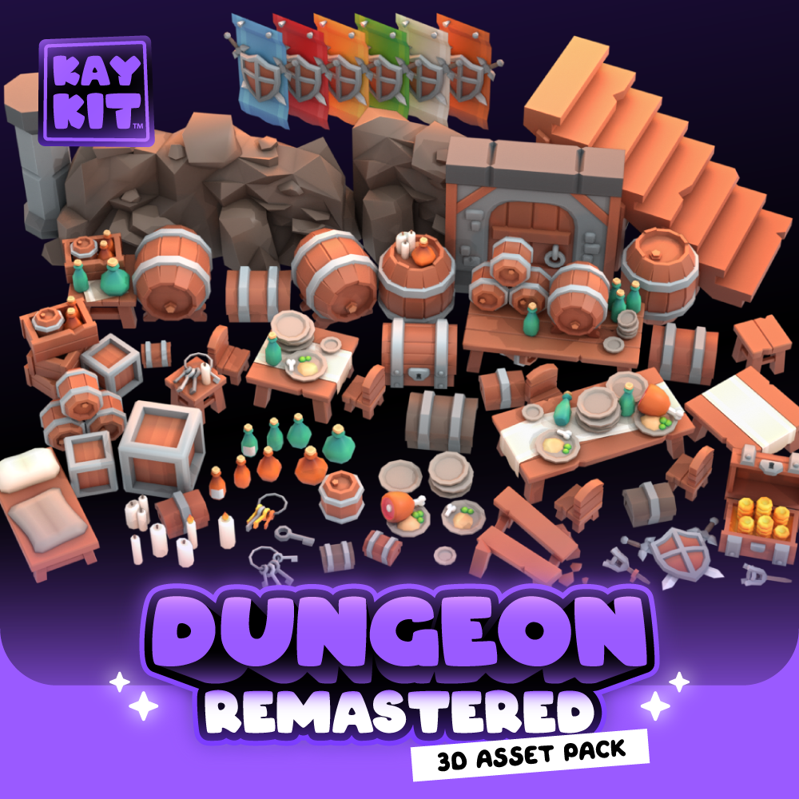

# assets-3d-lowpoly

3D 로우폴리 모델. glTF(GLB)·OBJ 등 게임엔진/웹에서 바로 쓸 수 있는 형식의 CC0 팩.

## 수록 팩

### Fantasy Town Kit 1.0

- 파일: `fantasy-town-kit-1.0.zip` (모델 153종 × GLB/OBJ/DAE/STL + PNG 텍스처) — 릴리스 v1.0 첨부
- 제작: Kenney / 라이선스: CC0 / 원본: https://kenney.nl/assets/fantasy-town-kit

### Nature Kit 2.1

- 파일: `kenney_natureKit_2.1.zip` (모델 329종 × GLB/OBJ/DAE/STL + PNG 텍스처) — 릴리스 v1.0 첨부
- 제작: Kenney / 라이선스: CC0 / 원본: https://kenney.nl/assets/nature-kit

### KayKit Adventurers 1.0

- 파일: `kaykit-adventurers-1.0.zip` (릴리스 v1.1 첨부): 캐릭터 5종(기사·마법사·도적·후드 도적·야만전사) GLB — 각 76종 애니메이션 내장 + 무기·소품 glTF 27종
- 제작: Kay Lousberg / 라이선스: CC0 / 원본: https://github.com/KayKit-Game-Assets/KayKit-Character-Pack-Adventures-1.0

### KayKit Dungeon Remastered 1.0

- 파일: `kaykit-dungeon-remastered-1.0.zip` (릴리스 v1.1 첨부): 모듈식 던전 모델 203종 GLB + 208종 OBJ
- 제작: Kay Lousberg / 라이선스: CC0 / 원본: https://github.com/KayKit-Game-Assets/KayKit-Dungeon-Remastered-1.0

## 다운로드

zip은 릴리스에 첨부되어 있습니다 (웹 업로드 방식의 한계로 릴리스 방식 사용):
[최신 릴리스에서 받기](https://github.com/sigco3111/assets-3d-lowpoly/releases/latest)
- v1.0: Kenney Fantasy Town Kit, Nature Kit
- v1.1: KayKit Adventurers, Dungeon Remastered

## 사용 방법

1. 릴리스에서 원하는 zip을 내려받아 프로젝트에 압축 해제
2. CC0이므로 귀속 표기 없이 사용 가능 (표기 시 "Kenney (kenney.nl)", "Kay Lousberg (kaylousberg.com)")

## 출처와 라이선스 기록

- 원본 라이선스 전문: 각 zip 안에 제작자가 배포한 License.txt 원본이 그대로 보존되어 있습니다 (법적 효력은 이 원본 기준).
- 이 저장소 루트의 LICENSE.md는 원본을 대체하지 않는 수집자 요약본입니다.
- Kenney 팩: 원본 배포 페이지의 라이선스 조건(CC0)과 동봉된 License.txt를 확인. 파일 바이트는 Kenney 공식 미러 github.com/ETdoFresh/kenney.nl 에서 확보했으며, 공식 사이트 원본과 바이트 대조는 하지 않았습니다.
- KayKit 팩: 제작자 공식 GitHub 저장소의 원본 바이트를 그대로 보존했고, 동봉 LICENSE.txt(CC0)를 확인했습니다.

전체 인덱스와 장르 태그: [game-asset-catalog](https://github.com/sigco3111/game-asset-catalog)

## 2026-10-28 추가 팩 (릴리스 v2.0)

### Car Kit

- 파일: [릴리스 v2.0 첨부 다운로드](https://github.com/sigco3111/assets-3d-lowpoly/releases/download/v2.0/car-kit.zip) (5MB, 모델 56종: 조립식 차량 GLB/OBJ)
- 제작: Kenney / 라이선스: CC0 / 원본: https://kenney.nl/assets/car-kit
### Castle Kit 1.0

- 파일: [릴리스 v2.0 첨부 다운로드](https://github.com/sigco3111/assets-3d-lowpoly/releases/download/v2.0/castle-kit.zip) (5.6MB, 모델 60종: 성 건물 GLB/OBJ)
- 제작: Kenney / 라이선스: CC0 / 원본: https://kenney.nl/assets/castle-kit
### Racing Pack

- 파일: [릴리스 v2.0 첨부 다운로드](https://github.com/sigco3111/assets-3d-lowpoly/releases/download/v2.0/racing-pack.zip) (1.4MB, 레이싱 차량·트랙 모델)
- 제작: Kenney / 라이선스: CC0 / 원본: https://kenney.nl/assets/racing-pack
### KayKit Skeletons 1.0

- 파일: [릴리스 v2.0 첨부 다운로드](https://github.com/sigco3111/assets-3d-lowpoly/releases/download/v2.0/kaykit-skeletons-1.0.zip) (29MB 분할, 스켈레톤 캐릭터 4종 glTF/FBX)
  - 25MB 업로드 제한으로 3개 분할: `.z01`, `.z02`, `.zip`을 같은 폴더에 받은 뒤 `zip -s 0 kaykit-skeletons-1.0.zip --out kaykit-skeletons-1.0-full.zip`으로 합쳐서 사용
- 제작: Kay Lousberg / 라이선스: CC0 / 원본: https://github.com/KayKit-Game-Assets/KayKit-Character-Pack-Skeletons-1.0
### KayKit City Builder Bits 1.0

- 파일: [릴리스 v2.0 첨부 다운로드](https://github.com/sigco3111/assets-3d-lowpoly/releases/download/v2.0/kaykit-city-builder-bits-1.0.zip) (5.8MB, 도시 건물 모델 glTF/OBJ/FBX)
- 제작: Kay Lousberg / 라이선스: CC0 / 원본: https://github.com/KayKit-Game-Assets/KayKit-City-Builder-Bits-1.0
### KayKit Space Base Bits 1.0

- 파일: [릴리스 v2.0 첨부 다운로드](https://github.com/sigco3111/assets-3d-lowpoly/releases/download/v2.0/kaykit-space-base-bits-1.0.zip) (6.2MB, 우주 기지 모델 glTF/OBJ/FBX)
- 제작: Kay Lousberg / 라이선스: CC0 / 원본: https://github.com/KayKit-Game-Assets/KayKit-Space-Base-Bits-1.0
