# assets-3d-lowpoly

3D 로우폴리 모델. glTF(GLB)·OBJ 등 게임엔진/웹에서 바로 쓸 수 있는 형식의 CC0·CC-BY 팩. CC-BY 팩은 사용 시 저작자 표기 필요 (각 팩 LICENSE-SOURCE.txt에 원본 저작자·정확한 CC 버전·출처·변경 내역 기록).

## 수록 팩

### Fantasy Town Kit 1.0

- 파일: `fantasy-town-kit-1.0.zip` (모델 153종 × GLB/OBJ/DAE/STL + PNG 텍스처) — 릴리스 v1.0 첨부
- 제작: Kenney / 라이선스: CC0 / 원본: https://kenney.nl/assets/fantasy-town-kit

### Nature Kit 2.1

- 파일: `kenney_natureKit_2.1.zip` (모델 329종 × GLB/OBJ/DAE/STL + PNG 텍스처) — 릴리스 v1.0 첨부
- 제작: Kenney / 라이선스: CC0 / 원본: https://kenney.nl/assets/nature-kit

### KayKit Adventurers 1.0

- 파일: `kaykit-adventurers-1.0.zip` (릴리스 v1.1 첨부): 캐릭터 5종(기사·마법사·도적·후드 도적·야만전사) GLB — 각 76종 애니메이션 내장 + 무기·소품 glTF 27종
- 제작: Kay Lousberg / 라이선스: CC0 / 원본: https://github.com/KayKit-Game-Assets/KayKit-Character-Pack-Adventures-1.0

### KayKit Dungeon Remastered 1.0

- 파일: `kaykit-dungeon-remastered-1.0.zip` (릴리스 v1.1 첨부): 모듈식 던전 모델 203종 GLB + 208종 OBJ
- 제작: Kay Lousberg / 라이선스: CC0 / 원본: https://github.com/KayKit-Game-Assets/KayKit-Dungeon-Remastered-1.0

## 다운로드

zip은 릴리스에 첨부되어 있습니다 (웹 업로드 방식의 한계로 릴리스 방식 사용):
[최신 릴리스에서 받기](https://github.com/sigco3111/assets-3d-lowpoly/releases/latest)
- v1.0: Kenney Fantasy Town Kit, Nature Kit
- v1.1: KayKit Adventurers, Dungeon Remastered

## 사용 방법

1. 릴리스에서 원하는 zip을 내려받아 프로젝트에 압축 해제
2. CC0이므로 귀속 표기 없이 사용 가능 (표기 시 "Kenney (kenney.nl)", "Kay Lousberg (kaylousberg.com)")

## 출처와 라이선스 기록

- 원본 라이선스 전문: 각 zip 안에 제작자가 배포한 License.txt 원본이 그대로 보존되어 있습니다 (법적 효력은 이 원본 기준). 다만 원본에 라이선스 파일이 없는 Quaternius Animated Zombie·Cute Monsters 2개 팩은 공식 팩 페이지의 CC0 표기를 근거로 수집자가 작성한 LICENSE-SOURCE.txt가 대신 동봉되어 있습니다.
- 이 저장소 루트의 LICENSE.md는 원본을 대체하지 않는 수집자 요약본입니다.
- Kenney 팩: 원본 배포 페이지의 라이선스 조건(CC0)과 동봉된 License.txt를 확인. 파일 바이트는 Kenney 공식 미러 github.com/ETdoFresh/kenney.nl 에서 확보했으며, 공식 사이트 원본과 바이트 대조는 하지 않았습니다.
- KayKit 팩: 제작자 공식 GitHub 저장소의 원본 바이트를 그대로 보존했고, 동봉 LICENSE.txt(CC0)를 확인했습니다.

전체 인덱스와 장르 태그: [game-asset-catalog](https://github.com/sigco3111/game-asset-catalog)

## 2026-10-28 추가 팩 (릴리스 v2.0)

### Car Kit

- 파일: [릴리스 v2.0 첨부 다운로드](https://github.com/sigco3111/assets-3d-lowpoly/releases/download/v2.0/car-kit.zip) (5MB, 모델 56종: 조립식 차량 GLB/OBJ)
- 제작: Kenney / 라이선스: CC0 / 원본: https://kenney.nl/assets/car-kit
### Castle Kit 1.0

- 파일: [릴리스 v2.0 첨부 다운로드](https://github.com/sigco3111/assets-3d-lowpoly/releases/download/v2.0/castle-kit.zip) (5.6MB, 모델 60종: 성 건물 GLB/OBJ)
- 제작: Kenney / 라이선스: CC0 / 원본: https://kenney.nl/assets/castle-kit

### KayKit Skeletons 1.0

- 파일: [릴리스 v2.0 첨부 다운로드](https://github.com/sigco3111/assets-3d-lowpoly/releases/download/v2.0/kaykit-skeletons-1.0.zip) (29MB 분할, 스켈레톤 캐릭터 4종 glTF/FBX)
  - 25MB 업로드 제한으로 3개 분할: `.z01`, `.z02`, `.zip`을 같은 폴더에 받은 뒤 `zip -s 0 kaykit-skeletons-1.0.zip --out kaykit-skeletons-1.0-full.zip`으로 합쳐서 사용
- 제작: Kay Lousberg / 라이선스: CC0 / 원본: https://github.com/KayKit-Game-Assets/KayKit-Character-Pack-Skeletons-1.0
### KayKit City Builder Bits 1.0

- 파일: [릴리스 v2.0 첨부 다운로드](https://github.com/sigco3111/assets-3d-lowpoly/releases/download/v2.0/kaykit-city-builder-bits-1.0.zip) (5.8MB, 도시 건물 모델 glTF/OBJ/FBX)
- 제작: Kay Lousberg / 라이선스: CC0 / 원본: https://github.com/KayKit-Game-Assets/KayKit-City-Builder-Bits-1.0
### KayKit Space Base Bits 1.0

- 파일: [릴리스 v2.0 첨부 다운로드](https://github.com/sigco3111/assets-3d-lowpoly/releases/download/v2.0/kaykit-space-base-bits-1.0.zip) (6.2MB, 우주 기지 모델 glTF/OBJ/FBX)
- 제작: Kay Lousberg / 라이선스: CC0 / 원본: https://github.com/KayKit-Game-Assets/KayKit-Space-Base-Bits-1.0

## 2026-10-28 추가 팩 (릴리스 v3.0)

### Graveyard Kit

- 파일: [릴리스 v3.0 첨부 다운로드](https://github.com/sigco3111/assets-3d-lowpoly/releases/download/v3.0/graveyard-kit.zip) (3.6MB, 파일 862개 GLB/OBJ 등)
- 제작: Kenney / 라이선스: CC0 / 원본: https://kenney.nl/assets/graveyard-kit
### Hexagon Kit

- 파일: [릴리스 v3.0 첨부 다운로드](https://github.com/sigco3111/assets-3d-lowpoly/releases/download/v3.0/hexagon-kit.zip) (5.7MB, 파일 951개 GLB/OBJ 등)
- 제작: Kenney / 라이선스: CC0 / 원본: https://kenney.nl/assets/hexagon-kit
### Pirate Kit

- 파일: [릴리스 v3.0 첨부 다운로드](https://github.com/sigco3111/assets-3d-lowpoly/releases/download/v3.0/pirate-kit.zip) (5.7MB, 파일 364개 GLB/OBJ 등)
- 제작: Kenney / 라이선스: CC0 / 원본: https://kenney.nl/assets/pirate-kit
### Modular Buildings

- 파일: [릴리스 v3.0 첨부 다운로드](https://github.com/sigco3111/assets-3d-lowpoly/releases/download/v3.0/modular-buildings.zip) (1.4MB, 파일 314개 GLB/OBJ 등)
- 제작: Kenney / 라이선스: CC0 / 원본: https://kenney.nl/assets/modular-buildings
### Space Kit

- 파일: [릴리스 v3.0 첨부 다운로드](https://github.com/sigco3111/assets-3d-lowpoly/releases/download/v3.0/space-kit.zip) (5.2MB, 파일 664개)
- 제작: Kenney / 라이선스: CC0 / 원본: https://kenney.nl/assets/space-kit
### Tower Defense Kit

- 파일: [릴리스 v3.0 첨부 다운로드](https://github.com/sigco3111/assets-3d-lowpoly/releases/download/v3.0/tower-defense-kit.zip) (6.6MB, 파일 1607개 GLB/OBJ 등)
- 제작: Kenney / 라이선스: CC0 / 원본: https://kenney.nl/assets/tower-defense-kit
### Food Kit

- 파일: [릴리스 v3.0 첨부 다운로드](https://github.com/sigco3111/assets-3d-lowpoly/releases/download/v3.0/food-kit.zip) (8.3MB, 파일 2205개 GLB/OBJ 등)
- 제작: Kenney / 라이선스: CC0 / 원본: https://kenney.nl/assets/food-kit
### Furniture Kit

- 파일: [릴리스 v3.0 첨부 다운로드](https://github.com/sigco3111/assets-3d-lowpoly/releases/download/v3.0/furniture-kit.zip) (5.2MB, 파일 1546개 GLB/OBJ 등)
- 제작: Kenney / 라이선스: CC0 / 원본: https://kenney.nl/assets/furniture-kit
### Racing Kit

- 파일: [릴리스 v3.0 첨부 다운로드](https://github.com/sigco3111/assets-3d-lowpoly/releases/download/v3.0/racing-kit.zip) (6.1MB, 파일 1263개 GLB/OBJ 등)
- 제작: Kenney / 라이선스: CC0 / 원본: https://kenney.nl/assets/racing-kit
### Platformer Kit

- 파일: [릴리스 v3.0 첨부 다운로드](https://github.com/sigco3111/assets-3d-lowpoly/releases/download/v3.0/platformer-kit.zip) (3MB, 파일 820개 GLB/OBJ 등)
- 제작: Kenney / 라이선스: CC0 / 원본: https://kenney.nl/assets/platformer-kit
### Blocky Characters

- 파일: [릴리스 v3.0 첨부 다운로드](https://github.com/sigco3111/assets-3d-lowpoly/releases/download/v3.0/blocky-characters.zip) (1.4MB, 파일 56개)
- 제작: Kenney / 라이선스: CC0 / 원본: https://kenney.nl/assets/blocky-characters
### 3D Road Tiles

- 파일: [릴리스 v3.0 첨부 다운로드](https://github.com/sigco3111/assets-3d-lowpoly/releases/download/v3.0/3d-road-tiles.zip) (3.7MB, 파일 915개 GLB/OBJ 등)
- 제작: Kenney / 라이선스: CC0 / 원본: https://kenney.nl/assets/3d-road-tiles
### Watercraft Kit

- 파일: [릴리스 v3.0 첨부 다운로드](https://github.com/sigco3111/assets-3d-lowpoly/releases/download/v3.0/watercraft-kit.zip) (1.8MB, 파일 97개; 공식 페이지명 Watercraft Kit(구 Watercraft pack))
- 제작: Kenney / 라이선스: CC0 / 원본: https://kenney.nl/assets/watercraft-kit
### Minigolf Kit

- 파일: [릴리스 v3.0 첨부 다운로드](https://github.com/sigco3111/assets-3d-lowpoly/releases/download/v3.0/minigolf-kit.zip) (1.8MB, 파일 633개 GLB/OBJ 등)
- 제작: Kenney / 라이선스: CC0 / 원본: https://kenney.nl/assets/minigolf-kit

### Holiday Kit

- 파일: [릴리스 v3.0 첨부 다운로드](https://github.com/sigco3111/assets-3d-lowpoly/releases/download/v3.0/holiday-kit.zip) (3.6MB, 파일 543개(GLB/OBJ/STL 47종 등))
- 제작: Kenney / 라이선스: CC0 / 원본: https://kenney.nl/assets/holiday-kit
### KayKit Furniture Bits 1.0

- 파일: [릴리스 v3.0 첨부 다운로드](https://github.com/sigco3111/assets-3d-lowpoly/releases/download/v3.0/kaykit-furniture-bits-1.0.zip) (1.1MB, 파일 216개 glTF/OBJ/FBX)
- 제작: Kay Lousberg / 라이선스: CC0 / 원본: https://github.com/KayKit-Game-Assets/KayKit-Furniture-Bits-1.0
### KayKit Halloween Bits 1.0

- 파일: [릴리스 v3.0 첨부 다운로드](https://github.com/sigco3111/assets-3d-lowpoly/releases/download/v3.0/kaykit-halloween-bits-1.0.zip) (1.9MB, 파일 270개 glTF/OBJ/FBX)
- 제작: Kay Lousberg / 라이선스: CC0 / 원본: https://github.com/KayKit-Game-Assets/KayKit-Halloween-Bits-1.0
### KayKit Medieval Hexagon Pack 1.0

- 파일: [릴리스 v3.0 첨부 다운로드](https://github.com/sigco3111/assets-3d-lowpoly/releases/download/v3.0/kaykit-medieval-hexagon-pack-1.0.zip) (8.9MB, 파일 996개 glTF/OBJ/FBX)
- 제작: Kay Lousberg / 라이선스: CC0 / 원본: https://github.com/KayKit-Game-Assets/KayKit-Medieval-Hexagon-Pack-1.0
### KayKit Prototype Bits 1.0

- 파일: [릴리스 v3.0 첨부 다운로드](https://github.com/sigco3111/assets-3d-lowpoly/releases/download/v3.0/kaykit-prototype-bits-1.0.zip) (1.5MB, 파일 302개 glTF/OBJ/FBX)
- 제작: Kay Lousberg / 라이선스: CC0 / 원본: https://github.com/KayKit-Game-Assets/KayKit-Prototype-Bits-1.0
### KayKit Restaurant Bits 1.0

- 파일: [릴리스 v3.0 첨부 다운로드](https://github.com/sigco3111/assets-3d-lowpoly/releases/download/v3.0/kaykit-restaurant-bits-1.0.zip) (3.8MB, 파일 592개 glTF/OBJ/FBX)
- 제작: Kay Lousberg / 라이선스: CC0 / 원본: https://github.com/KayKit-Game-Assets/KayKit-Restaurant-Bits-1.0

## 2026-10-28 추가 팩 (릴리스 v4.0)

Quaternius의 애니메이션 3D 팩 12종. 공식 배포 Google Drive에서 받은 원본 바이트이며, 각 팩 페이지의 CC0 조건을 확인했습니다.

### Animated Alien

- 파일: [릴리스 v4.0 첨부 다운로드](https://github.com/sigco3111/assets-3d-lowpoly/releases/download/v4.0/quaternius-animated-alien.zip) (5.0M, 파일 6개 glTF)
- 제작: Quaternius / 라이선스: CC0 / 원본: https://quaternius.com/packs/animatedalien.html
### Animated Dinosaurs

- 파일: [릴리스 v4.0 첨부 다운로드](https://github.com/sigco3111/assets-3d-lowpoly/releases/download/v4.0/quaternius-animated-dinosaurs.zip) (7.8M, 파일 14개 glTF)
- 제작: Quaternius / 라이선스: CC0 / 원본: https://quaternius.com/packs/animateddinosaurs.html
### Animated Mech

- 파일: [릴리스 v4.0 첨부 다운로드](https://github.com/sigco3111/assets-3d-lowpoly/releases/download/v4.0/quaternius-animated-mech.zip) (17M, 파일 10개 glTF)
- 제작: Quaternius / 라이선스: CC0 / 원본: https://quaternius.com/packs/animatedmech.html
### Animated Robot

- 파일: [릴리스 v4.0 첨부 다운로드](https://github.com/sigco3111/assets-3d-lowpoly/releases/download/v4.0/quaternius-animated-robot.zip) (5.9M, 파일 4개 glTF)
- 제작: Quaternius / 라이선스: CC0 / 원본: https://quaternius.com/packs/animatedrobot.html
### Animated Zombie

- 파일: [릴리스 v4.0 첨부 다운로드](https://github.com/sigco3111/assets-3d-lowpoly/releases/download/v4.0/quaternius-animated-zombie.zip) (584K, 파일 6개 glTF)
- 제작: Quaternius / 라이선스: CC0 / 원본: https://quaternius.com/packs/animatedzombie.html
### Cars

- 파일: [릴리스 v4.0 첨부 다운로드](https://github.com/sigco3111/assets-3d-lowpoly/releases/download/v4.0/quaternius-cars.zip) (1.3M, 파일 16개 glTF)
- 제작: Quaternius / 라이선스: CC0 / 원본: https://quaternius.com/packs/cars.html
### Cute Monsters

- 파일: [릴리스 v4.0 첨부 다운로드](https://github.com/sigco3111/assets-3d-lowpoly/releases/download/v4.0/quaternius-cute-monsters.zip) (9.2M, 파일 44개 glTF)
- 제작: Quaternius / 라이선스: CC0 / 원본: https://quaternius.com/packs/cutemonsters.html
### Farm Animals

- 파일: [릴리스 v4.0 첨부 다운로드](https://github.com/sigco3111/assets-3d-lowpoly/releases/download/v4.0/quaternius-farm-animals.zip) (4.7M, 파일 16개 glTF)
- 제작: Quaternius / 라이선스: CC0 / 원본: https://quaternius.com/packs/farmanimal.html
### Knight Character

- 파일: [릴리스 v4.0 첨부 다운로드](https://github.com/sigco3111/assets-3d-lowpoly/releases/download/v4.0/quaternius-knight-character.zip) (112K, 파일 19개 glTF)
- 제작: Quaternius / 라이선스: CC0 / 원본: https://quaternius.com/packs/knightcharacter.html
### Medieval Village

- 파일: [릴리스 v4.0 첨부 다운로드](https://github.com/sigco3111/assets-3d-lowpoly/releases/download/v4.0/quaternius-medieval-village.zip) (1.8M, 파일 89개 glTF)
- 제작: Quaternius / 라이선스: CC0 / 원본: https://quaternius.com/packs/medievalvillage.html
### RPG Characters

- 파일: [릴리스 v4.0 첨부 다운로드](https://github.com/sigco3111/assets-3d-lowpoly/releases/download/v4.0/quaternius-rpg-characters.zip) (13M, 파일 19개 glTF)
- 제작: Quaternius / 라이선스: CC0 / 원본: https://quaternius.com/packs/rpgcharacters.html
### Spaceships

- 파일: [릴리스 v4.0 첨부 다운로드](https://github.com/sigco3111/assets-3d-lowpoly/releases/download/v4.0/quaternius-spaceships.zip) (384K, 파일 12개 glTF)
- 제작: Quaternius / 라이선스: CC0 / 원본: https://quaternius.com/packs/spaceships.html

참고: Animated Zombie와 Cute Monsters는 원본 zip에 라이선스 파일이 없어, 공식 팩 페이지의 CC0 표기를 기록한 LICENSE-SOURCE.txt를 수집자가 동봉했습니다. 나머지 10팩은 원본 License.txt가 그대로 포함되어 있습니다.

## 분류 정정 안내 (2026-10-28)

Brick Pack, Modular Characters, Prototype Textures, Racing Pack, Robot Pack, Toon Characters, Voxel Pack 7팩은 3D 모델이 없는 2D 스프라이트·타일 6팩과 텍스처 1팩이어서 [assets-2d-pixel](https://github.com/sigco3111/assets-2d-pixel/releases/tag/v5.0) 저장소(릴리스 v5.0)로 옮겼습니다. 이 저장소 릴리스 v2.0·v3.0에 올려 둔 기존 파일은 지우지 않았으므로 예전 다운로드 링크는 그대로 동작합니다.

## 2026-10-28 추가 확장: 실제 파일 검증

### Low Poly Food Pack

- 다운로드: [low-poly-food-pack.zip](https://github.com/sigco3111/assets-3d-lowpoly/releases/download/v5.0/low-poly-food-pack.zip)
- 실제 내용: OBJ 103개 + FBX 103개 + BLEND 103개. 형식별 파일 수이며 서로 다른 모델 총수를 합산한 숫자가 아닙니다.
- 제작: Quaternius / 라이선스: CC0 / 출처: https://opengameart.org/content/low-poly-food-pack
- 원본 파일 내용은 바이트 그대로 보존했습니다. 수집자가 작성한 `LICENSE-SOURCE.txt`에 출처·라이선스 근거·원본 ZIP SHA-256을 기록했습니다. 원본 배포 ZIP에는 라이선스 파일이 없으며, 배포 페이지의 CC0 표기를 근거로 합니다.

### LowPoly Modular Sci-Fi Environments

- 다운로드: [lowpoly-modular-sci-fi-environments.zip](https://github.com/sigco3111/assets-3d-lowpoly/releases/download/v5.0/lowpoly-modular-sci-fi-environments.zip)
- 실제 내용: OBJ 91개 + FBX 91개 + BLEND 91개. 형식별 파일 수이며 서로 다른 모델 총수를 합산한 숫자가 아닙니다.
- 제작: Quaternius / 라이선스: CC0 / 출처: https://opengameart.org/content/lowpoly-modular-sci-fi-environments
- 원본 파일 내용은 바이트 그대로 보존했습니다. 수집자가 작성한 `LICENSE-SOURCE.txt`에 출처·라이선스 근거·원본 ZIP SHA-256을 기록했습니다. 원본 License.txt도 포함됩니다.

### LowPoly Modular Dungeon Pack

- 다운로드: [lowpoly-modular-dungeon-pack.zip](https://github.com/sigco3111/assets-3d-lowpoly/releases/download/v5.0/lowpoly-modular-dungeon-pack.zip)
- 실제 내용: OBJ 48개 + FBX 48개 + BLEND 48개. 형식별 파일 수이며 서로 다른 모델 총수를 합산한 숫자가 아닙니다.
- 제작: Quaternius / 라이선스: CC0 / 출처: https://opengameart.org/content/lowpoly-modular-dungeon-pack
- 원본 파일 내용은 바이트 그대로 보존했습니다. 수집자가 작성한 `LICENSE-SOURCE.txt`에 출처·라이선스 근거·원본 ZIP SHA-256을 기록했습니다. 원본 License.txt도 포함됩니다.

### LowPoly Modular Street Pack

- 다운로드: [lowpoly-modular-street-pack.zip](https://github.com/sigco3111/assets-3d-lowpoly/releases/download/v5.0/lowpoly-modular-street-pack.zip)
- 실제 내용: OBJ 25개 + FBX 25개 + BLEND 25개. 형식별 파일 수이며 서로 다른 모델 총수를 합산한 숫자가 아닙니다.
- 제작: Quaternius / 라이선스: CC0 / 출처: https://opengameart.org/content/lowpoly-modular-street-pack
- 원본 파일 내용은 바이트 그대로 보존했습니다. 수집자가 작성한 `LICENSE-SOURCE.txt`에 출처·라이선스 근거·원본 ZIP SHA-256을 기록했습니다. 원본 License.txt도 포함됩니다.

### LowPoly House Interior Pack

- 다운로드: [lowpoly-house-interior-pack.zip](https://github.com/sigco3111/assets-3d-lowpoly/releases/download/v5.0/lowpoly-house-interior-pack.zip)
- 실제 내용: OBJ 123개 + FBX 123개 + BLEND 123개. 형식별 파일 수이며 서로 다른 모델 총수를 합산한 숫자가 아닙니다.
- 제작: Quaternius / 라이선스: CC0 / 출처: https://opengameart.org/content/lowpoly-house-interior-pack
- 원본 파일 내용은 바이트 그대로 보존했습니다. 수집자가 작성한 `LICENSE-SOURCE.txt`에 출처·라이선스 근거·원본 ZIP SHA-256을 기록했습니다. 원본 배포 ZIP에는 라이선스 파일이 없으며, 배포 페이지의 CC0 표기를 근거로 합니다.

### LowPoly Textured Trees

- 다운로드: [lowpoly-textured-trees.zip](https://github.com/sigco3111/assets-3d-lowpoly/releases/download/v5.0/lowpoly-textured-trees.zip)
- 실제 내용: OBJ 45개 + FBX 45개 + BLEND 45개. 형식별 파일 수이며 서로 다른 모델 총수를 합산한 숫자가 아닙니다.
- 제작: Quaternius / 라이선스: CC0 / 출처: https://opengameart.org/content/lowpoly-textured-trees
- 원본 파일 내용은 바이트 그대로 보존했습니다. 수집자가 작성한 `LICENSE-SOURCE.txt`에 출처·라이선스 근거·원본 ZIP SHA-256을 기록했습니다. 원본 배포 ZIP에는 라이선스 파일이 없으며, 배포 페이지의 CC0 표기를 근거로 합니다.

### LowPoly Steampunk Turrets

- 다운로드: [lowpoly-steampunk-turrets.zip](https://github.com/sigco3111/assets-3d-lowpoly/releases/download/v5.0/lowpoly-steampunk-turrets.zip)
- 실제 내용: OBJ 37개 + FBX 37개 + BLEND 37개. 형식별 파일 수이며 서로 다른 모델 총수를 합산한 숫자가 아닙니다.
- 제작: Quaternius / 라이선스: CC0 / 출처: https://opengameart.org/content/lowpoly-steampunk-turrets
- 원본 파일 내용은 바이트 그대로 보존했습니다. 수집자가 작성한 `LICENSE-SOURCE.txt`에 출처·라이선스 근거·원본 ZIP SHA-256을 기록했습니다. 원본 License.txt도 포함됩니다.

### LowPoly Crops Pack

- 다운로드: [lowpoly-crops-pack.zip](https://github.com/sigco3111/assets-3d-lowpoly/releases/download/v5.0/lowpoly-crops-pack.zip)
- 실제 내용: OBJ 102개 + FBX 102개 + BLEND 102개. 형식별 파일 수이며 서로 다른 모델 총수를 합산한 숫자가 아닙니다.
- 제작: Quaternius / 라이선스: CC0 / 출처: https://opengameart.org/content/lowpoly-crops-pack
- 원본 파일 내용은 바이트 그대로 보존했습니다. 수집자가 작성한 `LICENSE-SOURCE.txt`에 출처·라이선스 근거·원본 ZIP SHA-256을 기록했습니다. 원본 배포 ZIP에는 라이선스 파일이 없으며, 배포 페이지의 CC0 표기를 근거로 합니다.

### Low Poly Guns Pack

- 다운로드: [low-poly-guns-pack.zip](https://github.com/sigco3111/assets-3d-lowpoly/releases/download/v5.0/low-poly-guns-pack.zip)
- 실제 내용: OBJ 55개 + FBX 55개 + BLEND 55개. 형식별 파일 수이며 서로 다른 모델 총수를 합산한 숫자가 아닙니다.
- 제작: Quaternius / 라이선스: CC0 / 출처: https://opengameart.org/content/low-poly-guns-pack
- 원본 파일 내용은 바이트 그대로 보존했습니다. 수집자가 작성한 `LICENSE-SOURCE.txt`에 출처·라이선스 근거·원본 ZIP SHA-256을 기록했습니다. 원본 배포 ZIP에는 라이선스 파일이 없으며, 배포 페이지의 CC0 표기를 근거로 합니다.

### Low Poly Nature Pack

- 다운로드: [low-poly-nature-pack-1.zip](https://github.com/sigco3111/assets-3d-lowpoly/releases/download/v5.0/low-poly-nature-pack-1.zip)
- 분할 파일 필수: [low-poly-nature-pack-1.z01](https://github.com/sigco3111/assets-3d-lowpoly/releases/download/v5.0/low-poly-nature-pack-1.z01)도 같은 폴더에 저장하세요. `zip -s 0 low-poly-nature-pack-1.zip --out nature-full.zip` 후 nature-full.zip을 압축 해제합니다. 원격 2개 파일로 재결합·압축 검사·원본 내용 대조 완료.
- 실제 내용: OBJ 150개 + FBX 150개 + BLEND 150개. 형식별 파일 수이며 서로 다른 모델 총수를 합산한 숫자가 아닙니다.
- 제작: Quaternius / 라이선스: CC0 / 출처: https://opengameart.org/content/low-poly-nature-pack-1
- 원본 파일 내용은 바이트 그대로 보존했습니다. 수집자가 작성한 `LICENSE-SOURCE.txt`에 출처·라이선스 근거·원본 ZIP SHA-256을 기록했습니다. 원본 License.txt도 포함됩니다.

### LowPoly Medieval Weapons

- 다운로드: [lowpoly-medieval-weapons.zip](https://github.com/sigco3111/assets-3d-lowpoly/releases/download/v5.0/lowpoly-medieval-weapons.zip)
- 실제 내용: OBJ 24개 + FBX 24개 + BLEND 24개. 형식별 파일 수이며 서로 다른 모델 총수를 합산한 숫자가 아닙니다.
- 제작: Quaternius / 라이선스: CC0 / 출처: https://opengameart.org/content/lowpoly-medieval-weapons
- 원본 파일 내용은 바이트 그대로 보존했습니다. 수집자가 작성한 `LICENSE-SOURCE.txt`에 출처·라이선스 근거·원본 ZIP SHA-256을 기록했습니다. 원본 배포 ZIP에는 라이선스 파일이 없으며, 배포 페이지의 CC0 표기를 근거로 합니다.

### LowPoly Animated Monsters

- 다운로드: [lowpoly-animated-monsters.zip](https://github.com/sigco3111/assets-3d-lowpoly/releases/download/v5.0/lowpoly-animated-monsters.zip)
- 실제 내용: OBJ 4개 + FBX 4개 + BLEND 4개. 형식별 파일 수이며 서로 다른 모델 총수를 합산한 숫자가 아닙니다.
- 제작: Quaternius / 라이선스: CC0 / 출처: https://opengameart.org/content/lowpoly-animated-monsters
- 원본 파일 내용은 바이트 그대로 보존했습니다. 수집자가 작성한 `LICENSE-SOURCE.txt`에 출처·라이선스 근거·원본 ZIP SHA-256을 기록했습니다. 원본 License.txt도 포함됩니다.

### LowPoly Posed Humans

- 다운로드: [lowpoly-posed-humans.zip](https://github.com/sigco3111/assets-3d-lowpoly/releases/download/v5.0/lowpoly-posed-humans.zip)
- 실제 내용: OBJ 28개 + FBX 28개 + BLEND 28개. 형식별 파일 수이며 서로 다른 모델 총수를 합산한 숫자가 아닙니다.
- 제작: Quaternius / 라이선스: CC0 / 출처: https://opengameart.org/content/lowpoly-posed-humans
- 원본 파일 내용은 바이트 그대로 보존했습니다. 수집자가 작성한 `LICENSE-SOURCE.txt`에 출처·라이선스 근거·원본 ZIP SHA-256을 기록했습니다. 원본 License.txt도 포함됩니다.

### LowPoly Public Transport

- 다운로드: [lowpoly-public-transport.zip](https://github.com/sigco3111/assets-3d-lowpoly/releases/download/v5.0/lowpoly-public-transport.zip)
- 실제 내용: OBJ 12개 + FBX 12개 + BLEND 12개. 형식별 파일 수이며 서로 다른 모델 총수를 합산한 숫자가 아닙니다.
- 제작: Quaternius / 라이선스: CC0 / 출처: https://opengameart.org/content/lowpoly-public-transport
- 원본 파일 내용은 바이트 그대로 보존했습니다. 수집자가 작성한 `LICENSE-SOURCE.txt`에 출처·라이선스 근거·원본 ZIP SHA-256을 기록했습니다. 원본 배포 ZIP에는 라이선스 파일이 없으며, 배포 페이지의 CC0 표기를 근거로 합니다.

### Animated Fish

- 다운로드: [animated-fish.zip](https://github.com/sigco3111/assets-3d-lowpoly/releases/download/v5.0/animated-fish.zip)
- 실제 내용: OBJ 7개 + FBX 7개 + BLEND 7개. 형식별 파일 수이며 서로 다른 모델 총수를 합산한 숫자가 아닙니다.
- 제작: Quaternius / 라이선스: CC0 / 출처: https://opengameart.org/content/animated-fish
- 원본 파일 내용은 바이트 그대로 보존했습니다. 수집자가 작성한 `LICENSE-SOURCE.txt`에 출처·라이선스 근거·원본 ZIP SHA-256을 기록했습니다. 원본 License.txt도 포함됩니다.

### LowPoly Ship Pack

- 다운로드: [lowpoly-ship-pack.zip](https://github.com/sigco3111/assets-3d-lowpoly/releases/download/v5.0/lowpoly-ship-pack.zip)
- 실제 내용: OBJ 6개 + FBX 6개 + BLEND 6개. 형식별 파일 수이며 서로 다른 모델 총수를 합산한 숫자가 아닙니다.
- 제작: Quaternius / 라이선스: CC0 / 출처: https://opengameart.org/content/lowpoly-ship-pack
- 원본 파일 내용은 바이트 그대로 보존했습니다. 수집자가 작성한 `LICENSE-SOURCE.txt`에 출처·라이선스 근거·원본 ZIP SHA-256을 기록했습니다. 원본 License.txt도 포함됩니다.

이 확장의 원격 파일 SHA-256을 모두 로컬과 대조했습니다. 3D 팩의 모델 헤더·OBJ 정점/면, 오디오 디코딩, SVG 문서를 실제 파일에서 확인했습니다.
Food와 Crops 원본 팩에 동일한 Coconut_Half.obj 1개가 포함되어 있습니다. 팩 구조 보존을 위해 둘 다 유지했으며 중복 팩으로 추가한 것은 아닙니다. 기존 Quaternius 12팩과 새 모델 파일 해시 중복은 없었습니다.

## v6.0 — Quaternius MegaKit·애니메이션 (2026-10-28)

제작자가 OpenGameArt에 직접 배포한 CC0 팩입니다. 각 zip 안에 원본 License 파일(CC0)이 들어 있습니다. 11MB 분할 zip 조각(.z01~.zip)은 모두 받은 뒤 같은 폴더에서 합쳐야 열립니다. macOS/Linux: `zip -s 0 <이름>.zip --out <이름>-full.zip` 후 압축 해제. Windows: 7-Zip에서 .zip 파일을 열면 자동으로 이어 읽습니다.

### Fantasy Props MegaKit
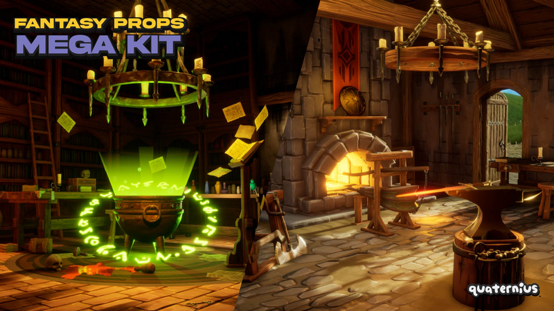
- 파일: `fantasy-props-megakit.zip` (모델 94종 GLB/OBJ/FBX) — 릴리스 v6.0 첨부, 11MB 분할 7조각
- 제작: Quaternius / 라이선스: CC0 / 원본: https://opengameart.org/content/fantasy-props-megakit

### Medieval Village MegaKit
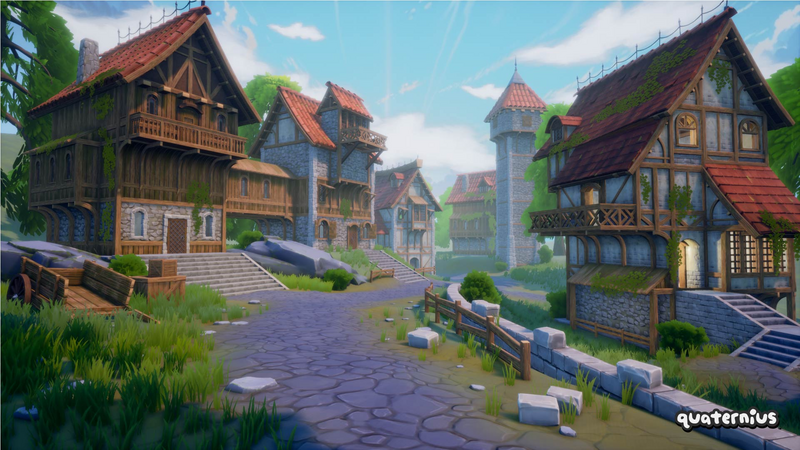
- 파일: `medieval-village-megakit.zip` (모델 176종 GLB/OBJ/FBX) — 릴리스 v6.0 첨부, 11MB 분할 9조각
- 제작: Quaternius / 라이선스: CC0 / 원본: https://opengameart.org/content/medieval-village-megakit

### Modular Sci-Fi MegaKit
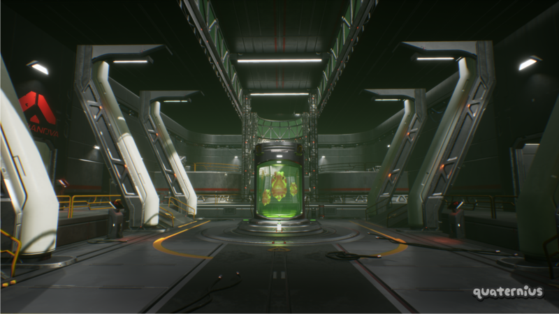
- 파일: `modular-sci-fi-megakit.zip` (모듈 191종 GLB/OBJ/FBX) — 릴리스 v6.0 첨부, 11MB 분할 5조각
- 제작: Quaternius / 라이선스: CC0 / 원본: https://opengameart.org/content/modular-sci-fi-megakit

### Stylized Nature MegaKit
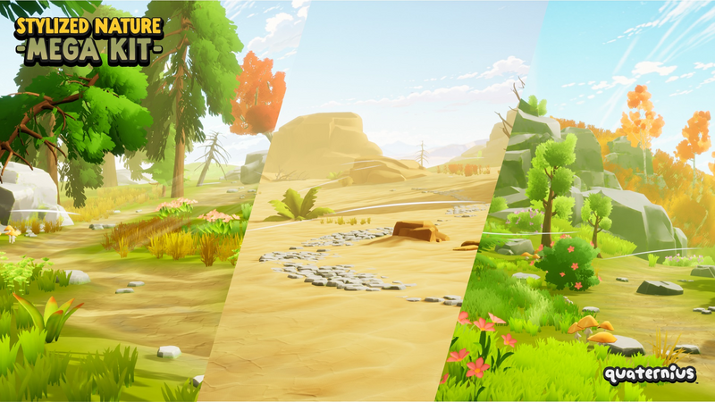
- 파일: `stylized-nature-megakit.zip` (모델 68종 GLB/OBJ/FBX) — 릴리스 v6.0 첨부, 11MB 분할 10조각
- 제작: Quaternius / 라이선스: CC0 / 원본: https://opengameart.org/content/stylized-nature-megakit

### Sci-Fi Essentials Kit (모델)
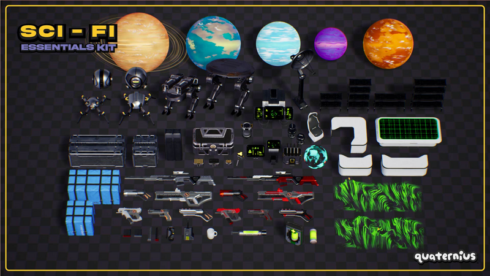
- 파일: `sci-fi-essentials-kit-models.zip` (모델 37종 GLB/OBJ/FBX) — 릴리스 v6.0 첨부, 11MB 분할 8조각
- 제작: Quaternius / 라이선스: CC0 / 원본: https://opengameart.org/content/sci-fi-essentials-kit
- 4K PBR 텍스처 36종(PNG)은 실제 내용이 이미지뿐이라 assets-2d-pixel v6.0으로 옮겼습니다. 이 저장소 v6.0 릴리스의 `sci-fi-essentials-kit-textures` 파일은 동일 바이트 사본으로 남겨 둡니다.

### Universal Animation Library
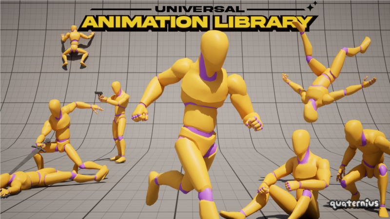
- 파일: `universal-animation-library.zip` (표준 마네킹 + 애니메이션 세트 GLB) — 릴리스 v6.0 첨부, 11MB 분할 2조각
- 제작: Quaternius / 라이선스: CC0 / 원본: https://opengameart.org/content/universal-animation-library

### Universal Animation Library 2
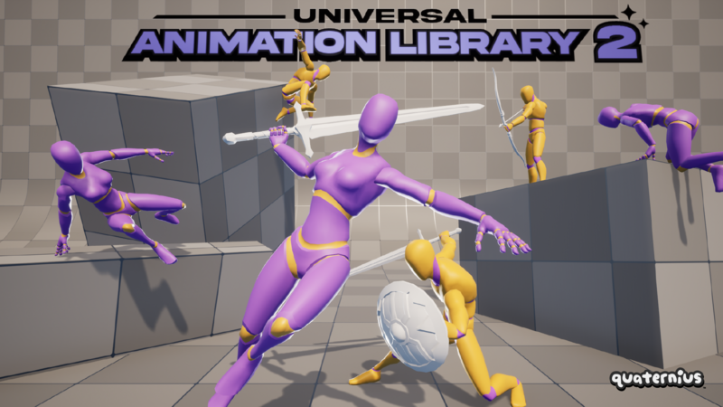
- 파일: `universal-animation-library-2.zip` (여성 마네킹 + 애니메이션 세트 GLB) — 릴리스 v6.0 첨부, 단일
- 제작: Quaternius / 라이선스: CC0 / 원본: https://opengameart.org/content/universal-animation-library-2

## 2026-10-28 추가 팩 (릴리스 v7.0)

OpenGameArt의 rubberduck 제작 CC0 3D 팩 10종. BLEND 원본 + 텍스처 위주 구성이며 GLB/OBJ로 내보내기가 필요할 수 있습니다.

### 3D Castle / Dungeon Tileset Extended
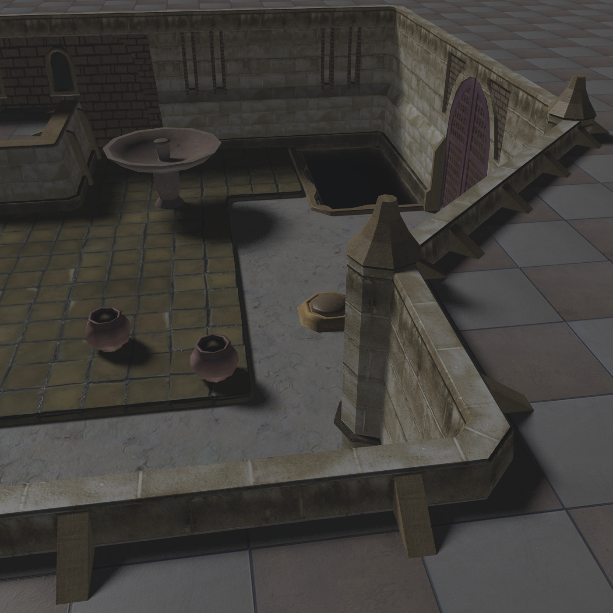
- 파일: `3d-castle-dungeon-tileset-extended.zip` (BLEND 1개 + 텍스처 JPG 36·PNG 14 + XCF 1) — 릴리스 v7.0 첨부, 11MB 분할 2조각 (`zip -s 0` 재결합)
- 제작: rubberduck / 라이선스: CC0 (원본 readme.txt 동봉) / 원본: https://opengameart.org/content/3d-castle-dungeon-tileset-extended
- 아래 기본판과 파일 12개 동일·3개 갱신된 확장판입니다.

### Free 3D Castle / Dungeon Tileset
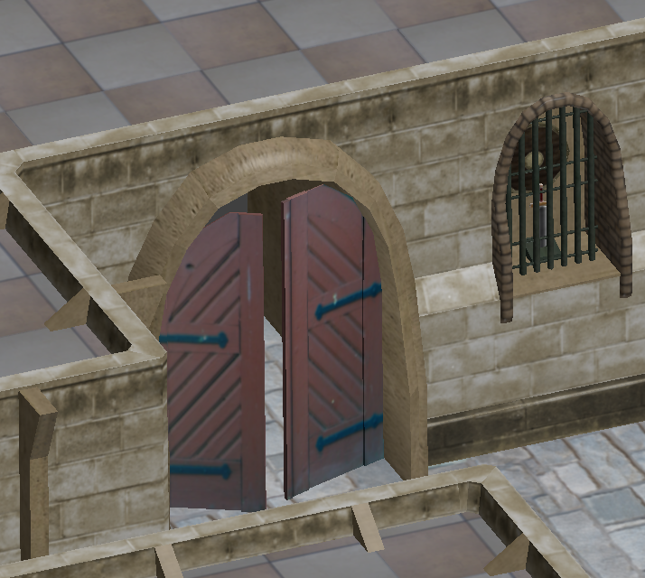
- 파일: `free-3d-castle-dungeon-tileset.zip` (BLEND 1개 + 텍스처 JPG 16·PNG 1) — 릴리스 v7.0 첨부, 11MB 분할 2조각 (`zip -s 0` 재결합)
- 제작: rubberduck / 라이선스: CC0 (원본 readme.txt 동봉) / 원본: https://opengameart.org/content/free-3d-castle-dungeon-tileset
- 확장판에 없는 기본판 전용 파일 4개가 있습니다.

### 3D Platformer Art Pack 1
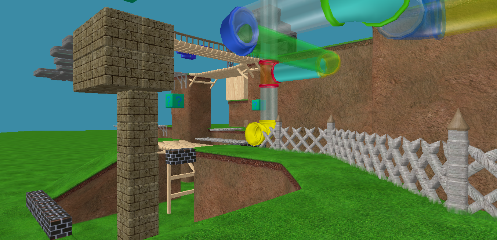
- 파일: `free-3d-platformer-art-pack-1.zip` (BLEND 2개 + 텍스처 PNG 39·JPG 16) — 릴리스 v7.0 첨부, 11MB 분할 5조각 (`zip -s 0` 재결합)
- 제작: rubberduck / 라이선스: CC0 / 원본: https://opengameart.org/content/free-3d-platformer-art-pack-1

### 3D Platformer Art Pack 2 - Fences
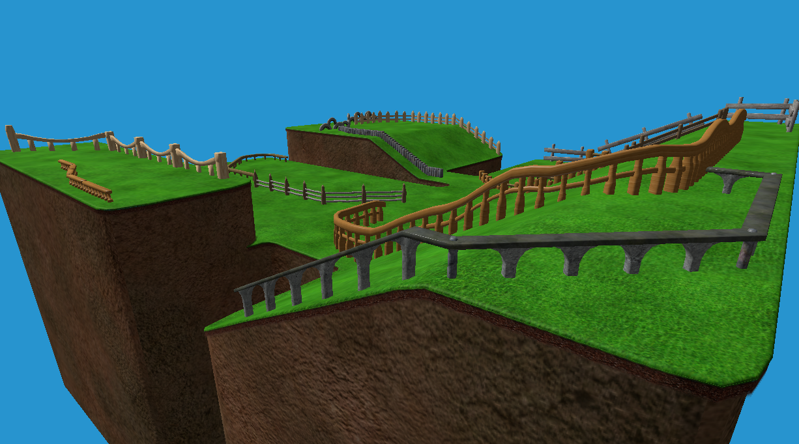
- 파일: `free-3d-platformer-art-pack-2-fences.zip` (BLEND 2개 + 텍스처 JPG 12·PNG 11) — 릴리스 v7.0 첨부, 11MB 분할 4조각 (`zip -s 0` 재결합)
- 제작: rubberduck / 라이선스: CC0 / 원본: https://opengameart.org/content/free-3d-platformer-art-pack-2-fences

### 3D Platformer Art Pack 3 - Terrain & Extras
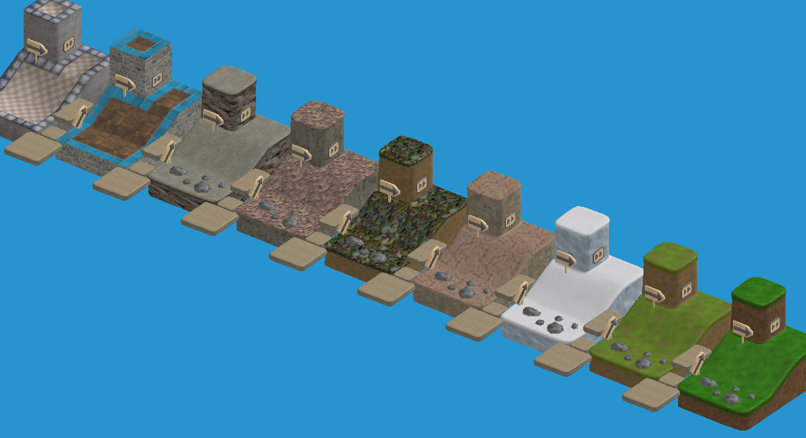
- 파일: `free-3d-platformer-art-pack-3-terrain-and-extras.zip` (BLEND 1개 + 텍스처 JPG 53·PNG 43 + XML 2) — 릴리스 v7.0 첨부, 11MB 분할 8조각 (`zip -s 0` 재결합)
- 제작: rubberduck / 라이선스: CC0 / 원본: https://opengameart.org/content/free-3d-platformer-art-pack-3-terrain-and-extras

### 3D Platformer Houses
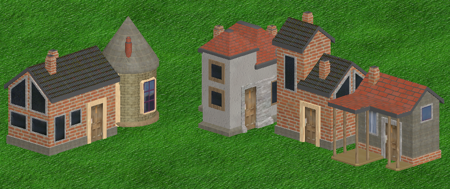
- 파일: `free-3d-platformer-houses.zip` (BLEND 1개 + 텍스처 JPG 22·PNG 6) — 릴리스 v7.0 첨부, 11MB 분할 3조각 (`zip -s 0` 재결합)
- 제작: rubberduck / 라이선스: CC0 / 원본: https://opengameart.org/content/free-3d-platformer-houses

### Vegetation Asset Pack
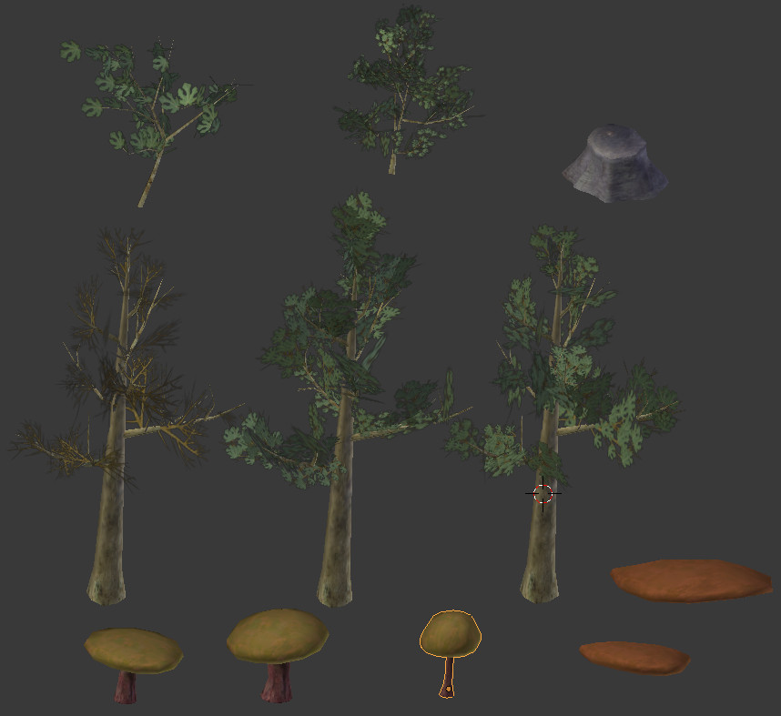
- 파일: `free-vegetation-asset-pack.zip` (BLEND 2개 + 텍스처 PNG 5·JPG 4) — 릴리스 v7.0 첨부, 단일
- 제작: rubberduck / 라이선스: CC0 / 원본: https://opengameart.org/content/free-vegetation-asset-pack

### Robot Character
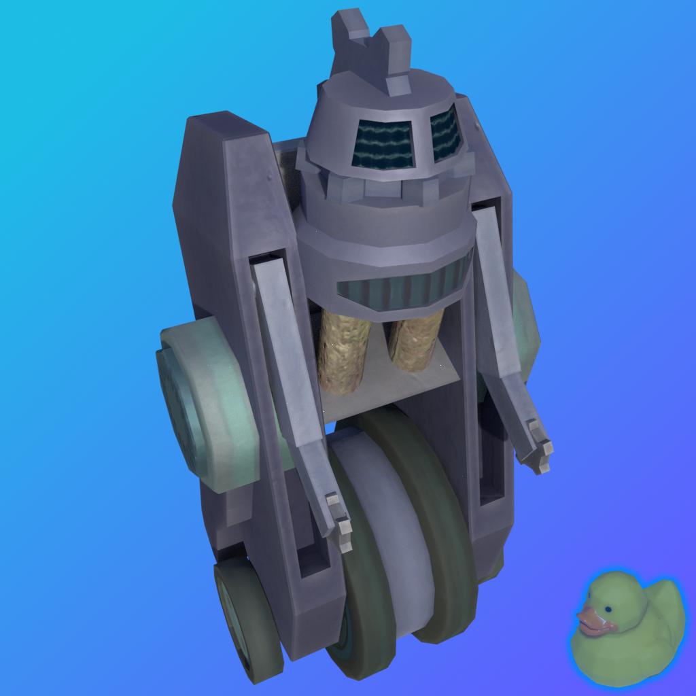
- 파일: `robot-character.zip` (BLEND 1개 + DAE 1 + 텍스처 PNG 14 + XCF 2 + Godot용 material/tscn 3) — 릴리스 v7.0 첨부
- 이 팩만 분할 방식이 다릅니다: 69.5MB라 `robot-character.zip.part1`~`part5` (15MB 조각 5개)로 나눴습니다. 재결합: `cat robot-character.zip.part* > robot-character.zip` (Windows: `copy /b robot-character.zip.part1+robot-character.zip.part2+robot-character.zip.part3+robot-character.zip.part4+robot-character.zip.part5 robot-character.zip`). 다른 팩의 `zip -s 0` 방식과 다르니 주의하세요.
- 제작: rubberduck / 라이선스: CC0 / 원본: https://opengameart.org/content/robot-character

### Vampire Bat (Animated)
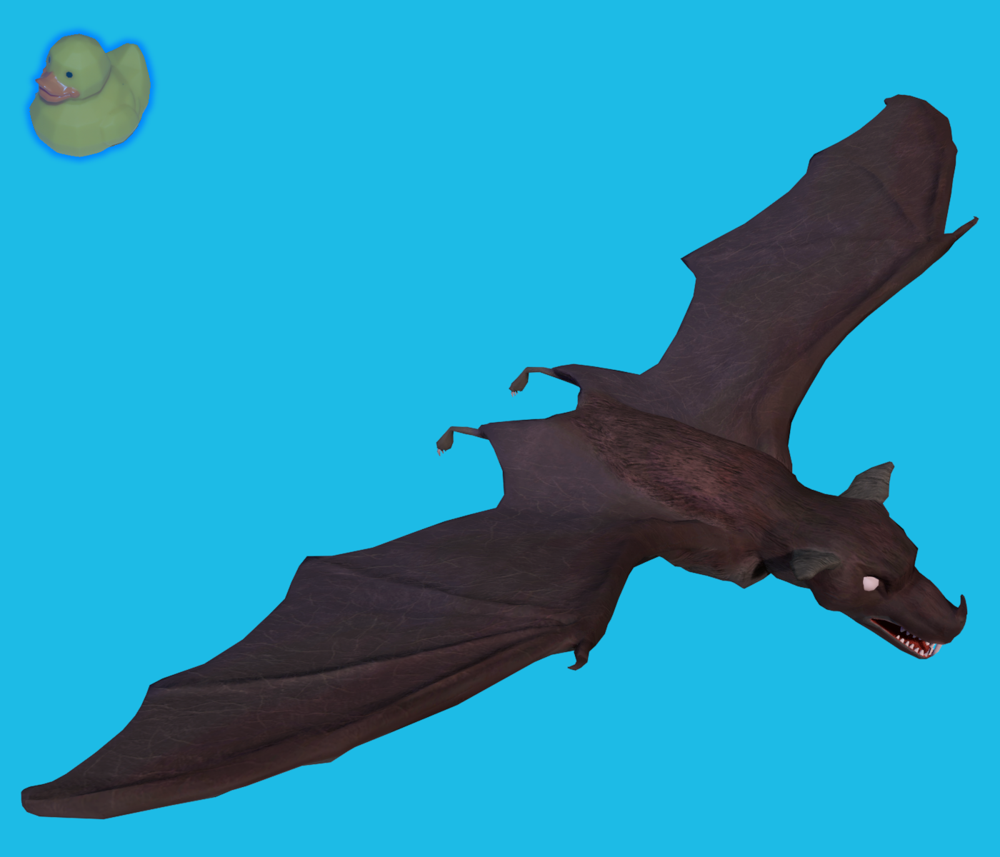
- 파일: `vampire-bat-animated.zip` (애니메이션 포함 BLEND 1개 + JPG 10 + XCF 1) — 릴리스 v7.0 첨부, 11MB 분할 2조각 (`zip -s 0` 재결합)
- 제작: rubberduck / 라이선스: CC0 / 원본: https://opengameart.org/content/vampire-bat-animated

### Industrial Asset Pack
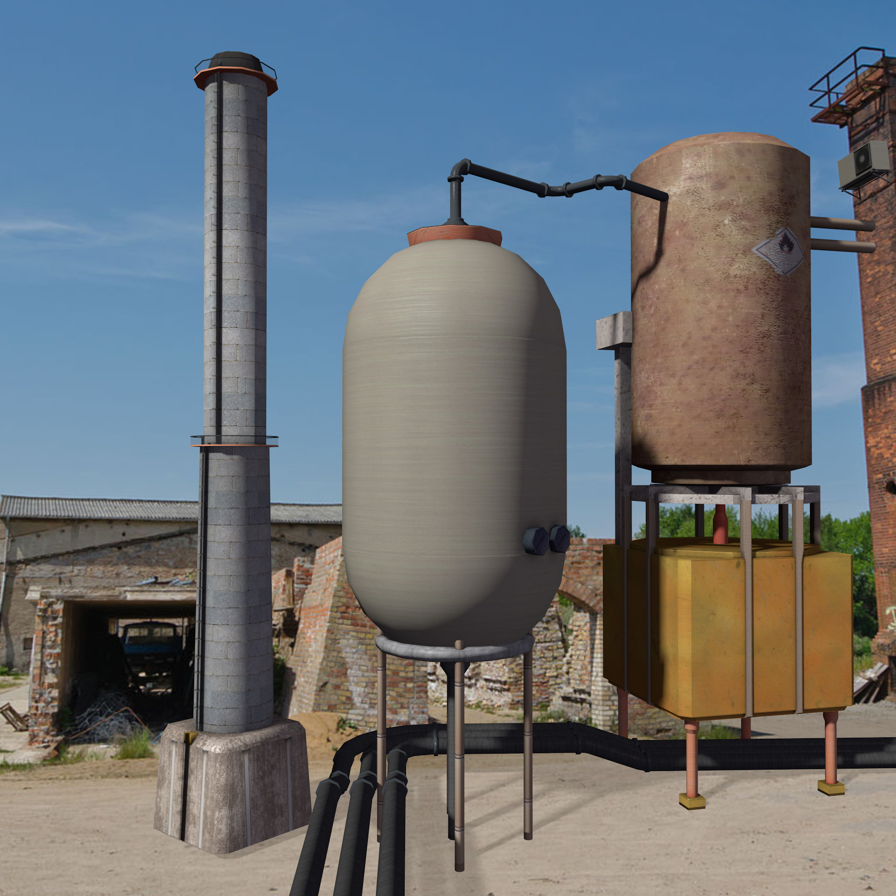
- 파일: `high-quality-industrial-asset-pack.zip` (BLEND 2개 + 텍스처 JPG 177·PNG 7) — 릴리스 v7.0 첨부, 11MB 분할 9조각 (`zip -s 0` 재결합)
- 제작: rubberduck / 라이선스: CC0 / 원본: https://opengameart.org/content/high-quality-industrial-asset-pack

## 2026-10-28 추가 팩 2차 (릴리스 v8.0)

모두 rubberduck (OpenGameArt) CC0 3D 팩. 원본 배포본에 라이선스 파일이 없어 수집자 작성 LICENSE-SOURCE.txt를 동봉했습니다. v8.0의 분할 팩은 모두 plain split 방식입니다: `cat <팩명>.zip.part* > <팩명>.zip` (Windows: `copy /b part1+part2+... <팩명>.zip`).

### 3D Collectable Pack
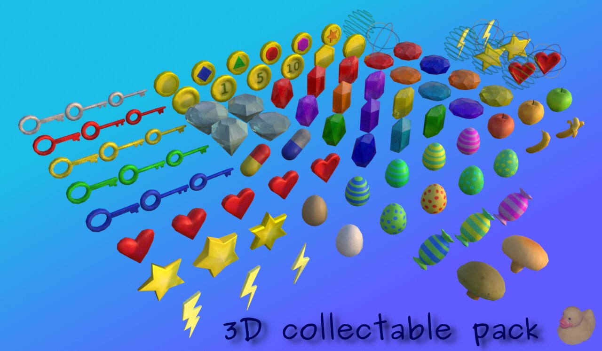
- 파일: `3d-collectable-pack.zip` (BLEND 1개 + PNG 23) — 릴리스 v8.0 첨부, 17.5MB plain split 2조각
- 제작: rubberduck / 라이선스: CC0 / 원본: https://opengameart.org/content/3d-collectable-pack

### 3D LOD Pipe Construction Set
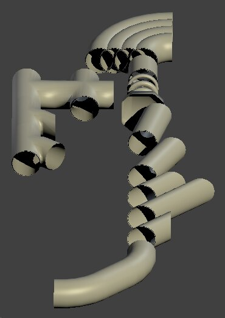
- 파일: `3d-lod-pipe-construction-set.zip` (BLEND 1개 + JPG 2) — 릴리스 v8.0 첨부, 단일
- 제작: rubberduck / 라이선스: CC0 / 원본: https://opengameart.org/content/3d-lod-pipe-construction-set

### 3D Mese Crystal
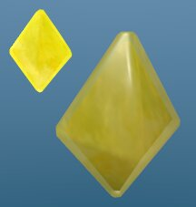
- 파일: `3d-mese-crystal.zip` (BLEND 1개 + PNG 3) — 릴리스 v8.0 첨부, 단일
- 제작: rubberduck / 라이선스: CC0 / 원본: https://opengameart.org/content/3d-mese-crystal

### 3D Platformer Brickblock Pack
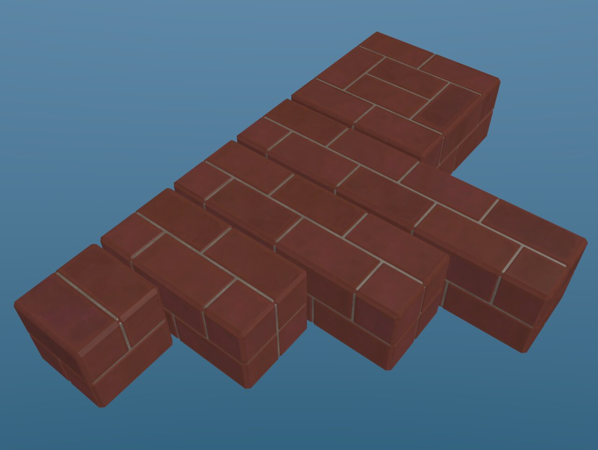
- 파일: `3d-platformer-brickblock-pack.zip` (BLEND 1개 + JPG 2) — 릴리스 v8.0 첨부, 단일
- 제작: rubberduck / 라이선스: CC0 / 원본: https://opengameart.org/content/3d-platformer-brickblock-pack

### 50 Fantasy RPG Asset Models
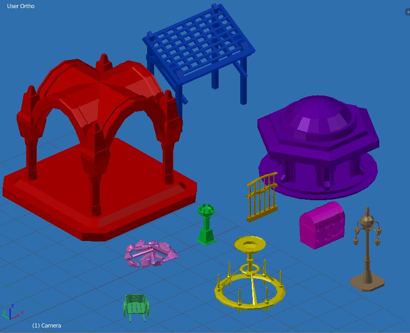
- 파일: `50-fantasy-rpg-asset-models.zip` (BLEND 1개, 모델 50개; bare blend를 zip으로 재압축) — 릴리스 v8.0 첨부, 단일
- 제작: rubberduck / 라이선스: CC0 / 원본: https://opengameart.org/content/50-fantasy-rpg-asset-models

### Abstract Fantasy Decoration Assets
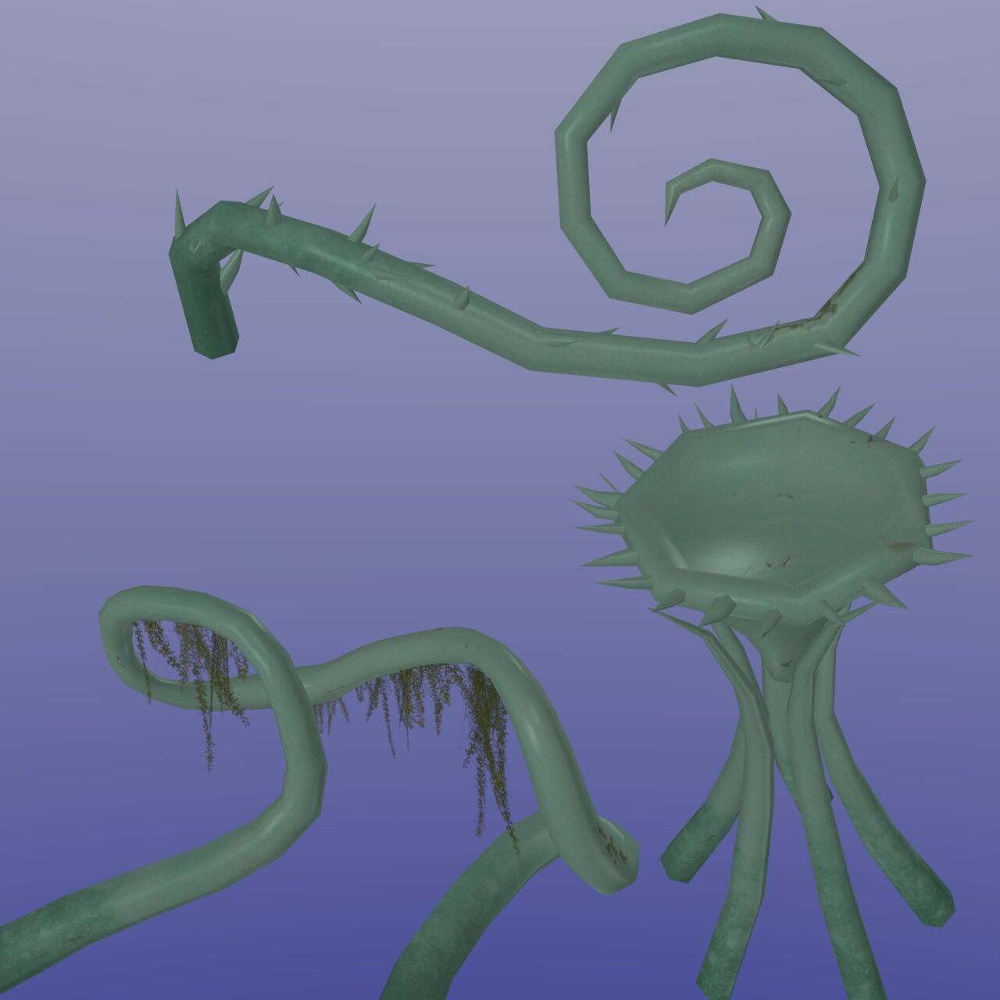
- 파일: `abstract-fantasy-decoration-assets.zip` (BLEND 1개 + JPG 1 + PNG 1) — 릴리스 v8.0 첨부, 단일
- 제작: rubberduck / 라이선스: CC0 / 원본: https://opengameart.org/content/abstract-fantasy-decoration-assets

### Alien Building/Base Set
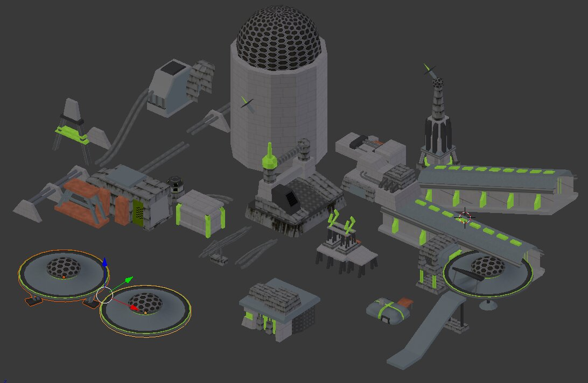
- 파일: `alien-buildingbase-set.zip` (BLEND 1개 + JPG 27 + PNG 3) — 릴리스 v8.0 첨부, 20MB plain split 2조각
- 제작: rubberduck / 라이선스: CC0 / 원본: https://opengameart.org/content/alien-buildingbase-set

### Alien Builings Extension Pack
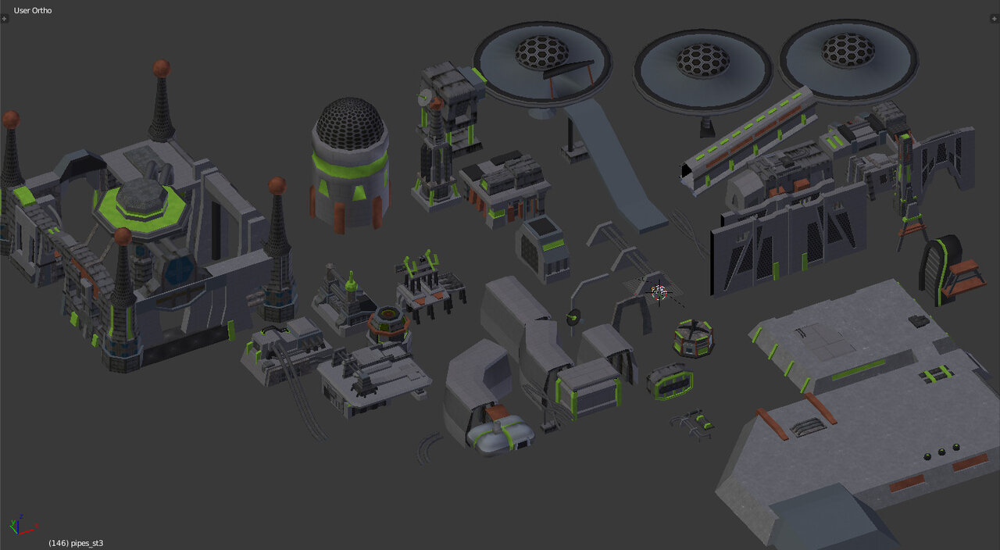
- 파일: `alien-builings-extension-pack.zip` (BLEND 1개 + JPG 65 + PNG 26 + TGA 3) — 릴리스 v8.0 첨부, 113MB plain split 8조각
- 제작: rubberduck / 라이선스: CC0 / 원본: https://opengameart.org/content/alien-builings-extension-pack

## 2026-10-28 추가 팩 3차 (릴리스 v8.1)

모두 rubberduck (OpenGameArt) CC0 3D 팩. 원본 배포본에 라이선스 파일이 없어 수집자 작성 LICENSE-SOURCE.txt를 동봉했습니다. 분할 팩 재결합: `cat <팩명>.zip.part* > <팩명>.zip` (Windows: `copy /b part1+part2 <팩명>.zip`).

### Basic 3D Platformer Pack
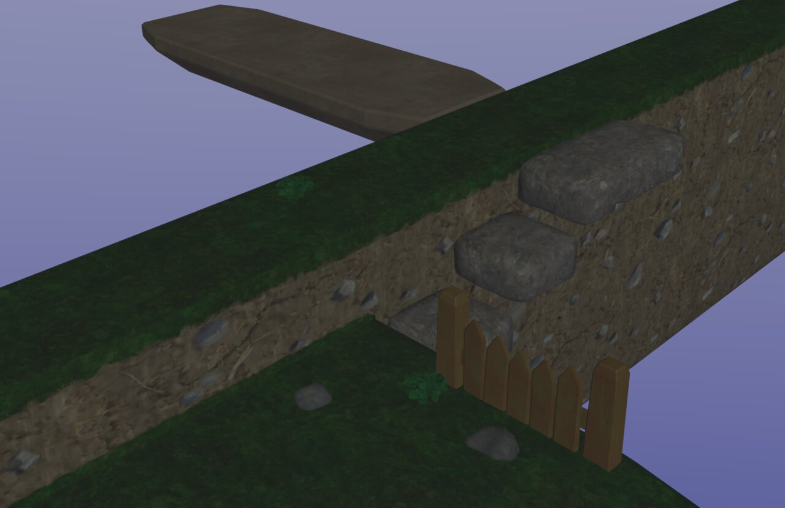
- 파일: `basic-3d-platformer-pack.zip` (BLEND 1개 + 텍스처 JPG 12·JPEG 3·PNG 9) — 릴리스 v8.1 첨부, 단일
- 제작: rubberduck / 라이선스: CC0 / 원본: https://opengameart.org/content/basic-3d-platformer-pack

### Colorful Bushes
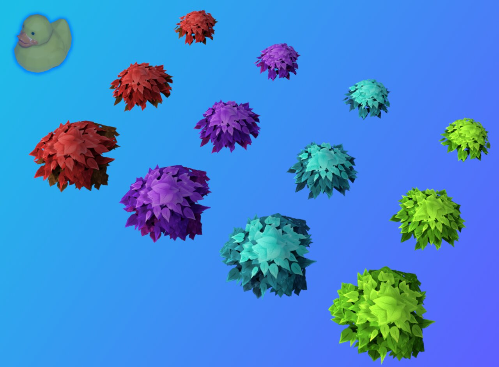
- 파일: `colorful-bushes.zip` (BLEND 1개 + DAE 3 + Godot용 tscn 12·material 4 + PNG 4) — 릴리스 v8.1 첨부, 단일
- 제작: rubberduck / 라이선스: CC0 / 원본: https://opengameart.org/content/colorful-bushes

### Container
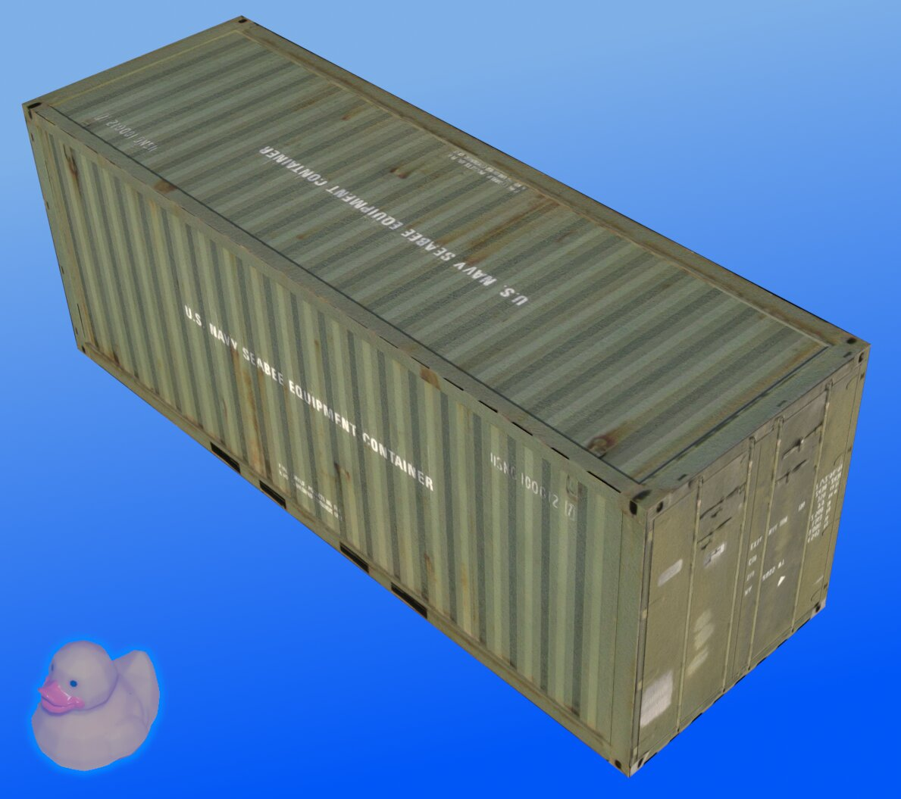
- 파일: `container-0.zip` (BLEND 1개 + PNG 10) — 릴리스 v8.1 첨부, 30MB plain split 2조각
- 제작: rubberduck / 라이선스: CC0 / 원본: https://opengameart.org/content/container-0

### Fantasy Torch Pack 1~4
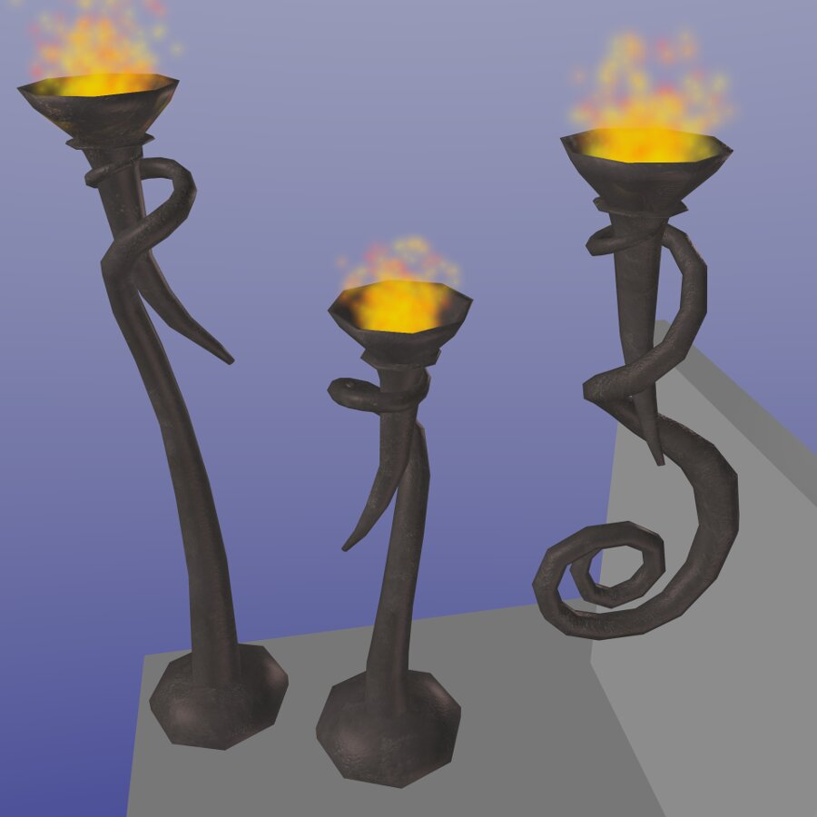
- 파일: `fantasy-torch-pack-1.zip` ~ `fantasy-torch-pack-4.zip` (각 BLEND 1개 + 텍스처/참고 JPG·PNG·XCF 수 개) — 릴리스 v8.1 첨부, 단일
- 제작: rubberduck / 라이선스: CC0 / 원본: https://opengameart.org/content/fantasy-torch-pack-1 (2, 3, 4도 동일 경로 규칙)

### Free 3D-Tileset-1
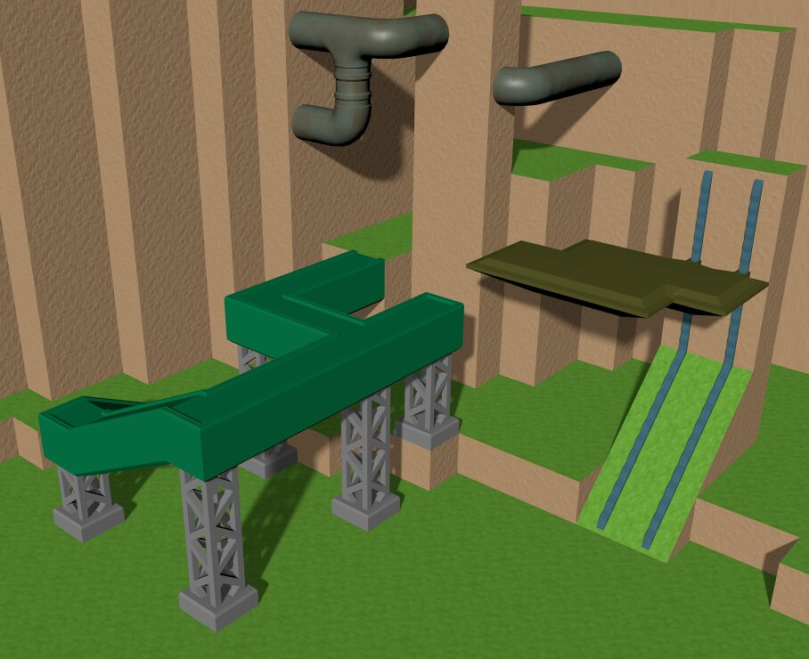
- 파일: `free-3d-tileset-1.zip` (BLEND 1개; bare blend를 zip으로 재압축) — 릴리스 v8.1 첨부, 단일
- 제작: rubberduck / 라이선스: CC0 / 원본: https://opengameart.org/content/free-3d-tileset-1

## 2026-10-28 추가 팩 4차 (릴리스 v8.2)

모두 rubberduck (OpenGameArt) CC0 3D 팩. 원본 배포본에 라이선스 파일이 없어 수집자 작성 LICENSE-SOURCE.txt를 동봉했습니다. 분할 팩 재결합: `cat <팩명>.zip.part* > <팩명>.zip` (Windows: `copy /b part1+part2+... <팩명>.zip`).

### Free 3D-Tileset-2 / Free 3D-Tileset-3 + Automapping Script
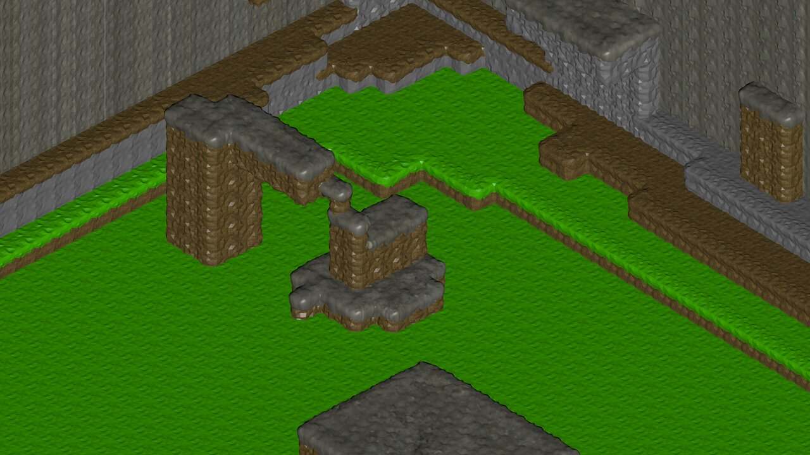
- 파일: `free-3d-tileset-2.zip`, `free-3d-tileset-3-automapping-script.zip` (각 BLEND 1개; bare blend를 zip으로 재압축) — 릴리스 v8.2 첨부, 단일
- 제작: rubberduck / 라이선스: CC0 / 원본: https://opengameart.org/content/free-3d-tileset-2 , https://opengameart.org/content/free-3d-tileset-3-automapping-script

### Free Mine Assets Pack
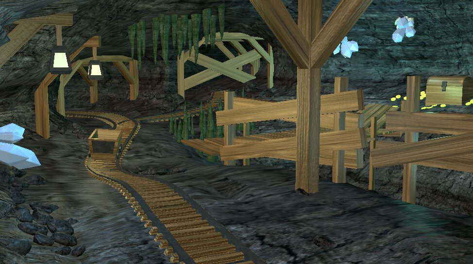
- 파일: `free-mine-assets-pack.zip` — 릴리스 v8.2 첨부, 15.9MB plain split 2조각
- 제작: rubberduck / 라이선스: CC0 / 원본: https://opengameart.org/content/free-mine-assets-pack

### Free Mug Pack #1
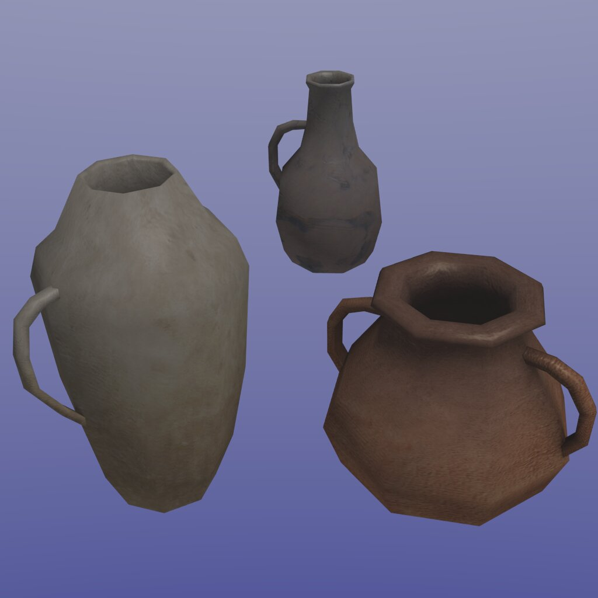
- 파일: `free-mug-pack-1.zip` — 릴리스 v8.2 첨부, 단일
- 제작: rubberduck / 라이선스: CC0 / 원본: https://opengameart.org/content/free-mug-pack-1

### Free Plant Pack
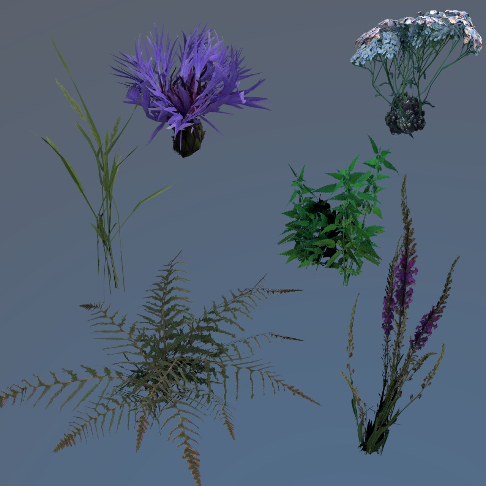
- 파일: `free-plant-pack.zip` — 릴리스 v8.2 첨부, 단일
- 제작: rubberduck / 라이선스: CC0 / 원본: https://opengameart.org/content/free-plant-pack

### Handpainted Style Rocks / Handpainted Stylized Sword
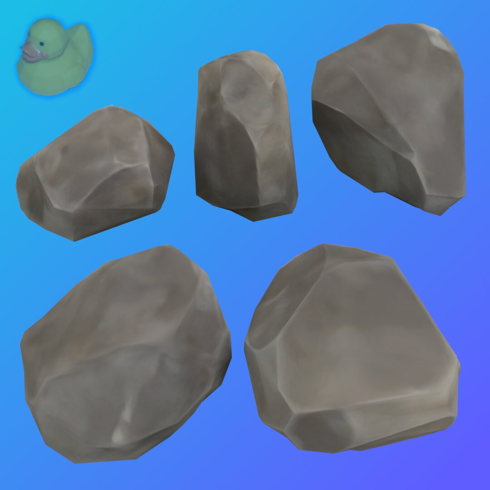
- 파일: `handpainted-style-rocks.zip`, `handpainted-stylized-sword.zip` — 릴리스 v8.2 첨부, 단일
- 제작: rubberduck / 라이선스: CC0 / 원본: https://opengameart.org/content/handpainted-style-rocks , https://opengameart.org/content/handpainted-stylized-sword

### Industrial Building #1
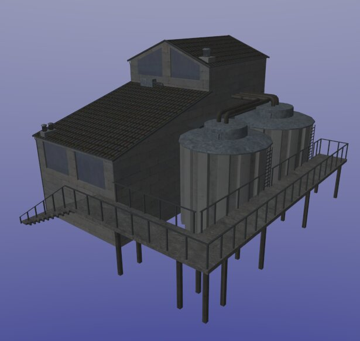
- 파일: `industrial-building-1.zip` — 릴리스 v8.2 첨부, 54.9MB plain split 4조각
- 제작: rubberduck / 라이선스: CC0 / 원본: https://opengameart.org/content/industrial-building-1

## 2026-10-28 추가 팩 5차 (릴리스 v8.3)

모두 rubberduck (OpenGameArt) CC0 3D 팩. 원본 배포본에 라이선스 파일이 없어 수집자 작성 LICENSE-SOURCE.txt를 동봉했습니다. 분할 팩 재결합: `cat <팩명>.zip.part* > <팩명>.zip` (Windows: `copy /b part1+part2+... <팩명>.zip`).

### Industrial Extension Pack 1: tanks
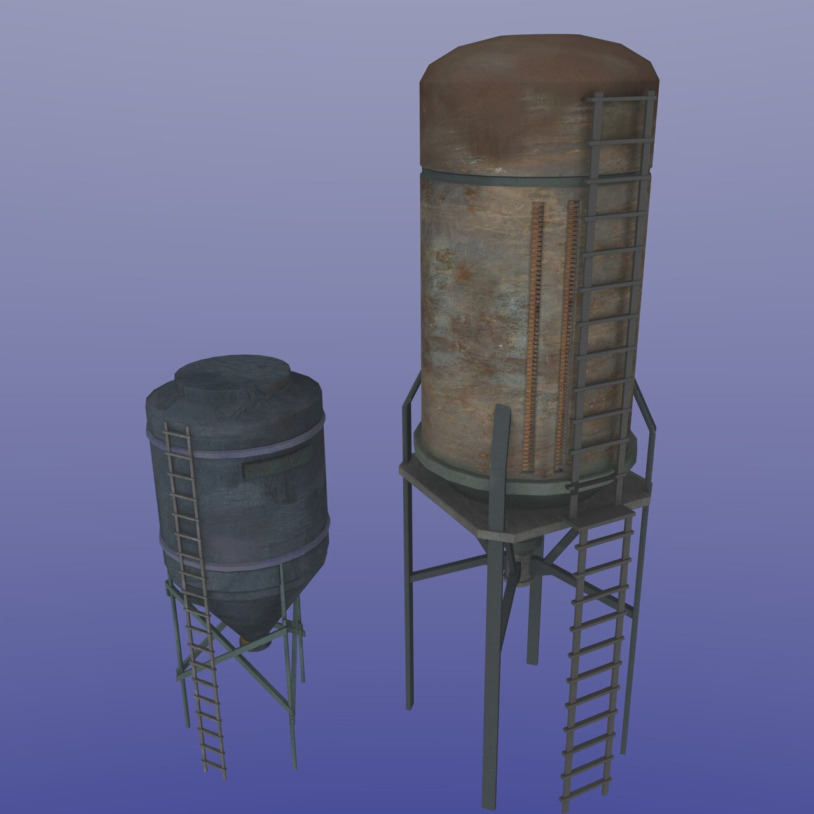
- 파일: `industrial-extension-pack-1-tanks.zip` — 릴리스 v8.3 첨부, 36.5MB plain split 3조각
- 제작: rubberduck / 라이선스: CC0 / 원본: https://opengameart.org/content/industrial-extension-pack-1-tanks

### Industrial Extension Pack 3: Factory Chimneys
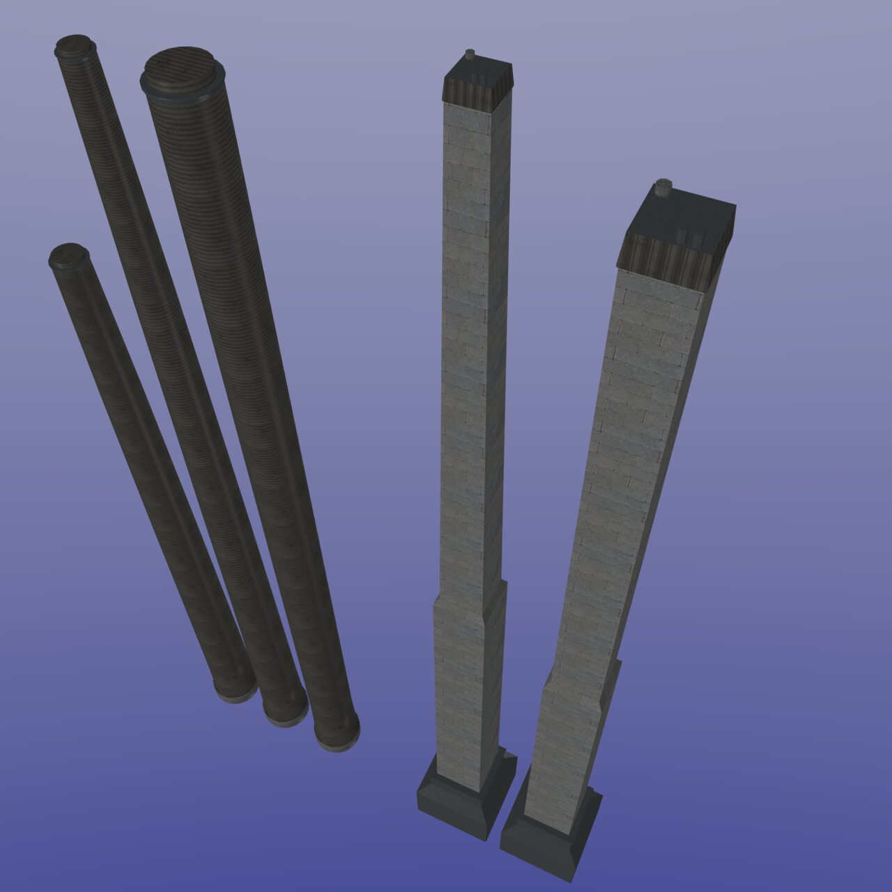
- 파일: `industrial-extension-pack-3-factory-chimneys.zip` — 릴리스 v8.3 첨부, 단일
- 제작: rubberduck / 라이선스: CC0 / 원본: https://opengameart.org/content/industrial-extension-pack-3-factory-chimneys

### Industrial Extension Pack 4: more tanks
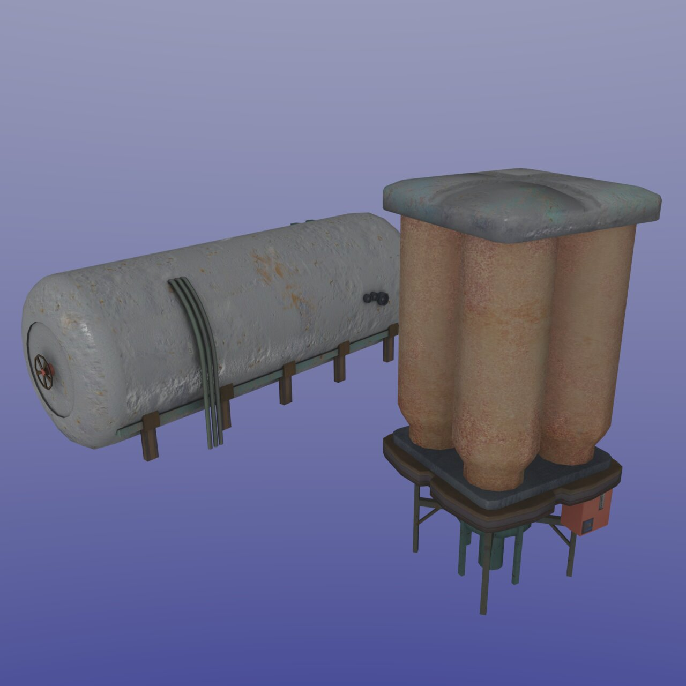
- 파일: `industrial-extension-pack-4-more-tanks.zip` — 릴리스 v8.3 첨부, 33.3MB plain split 3조각
- 제작: rubberduck / 라이선스: CC0 / 원본: https://opengameart.org/content/industrial-extension-pack-4-more-tanks

### isometric render resource pack
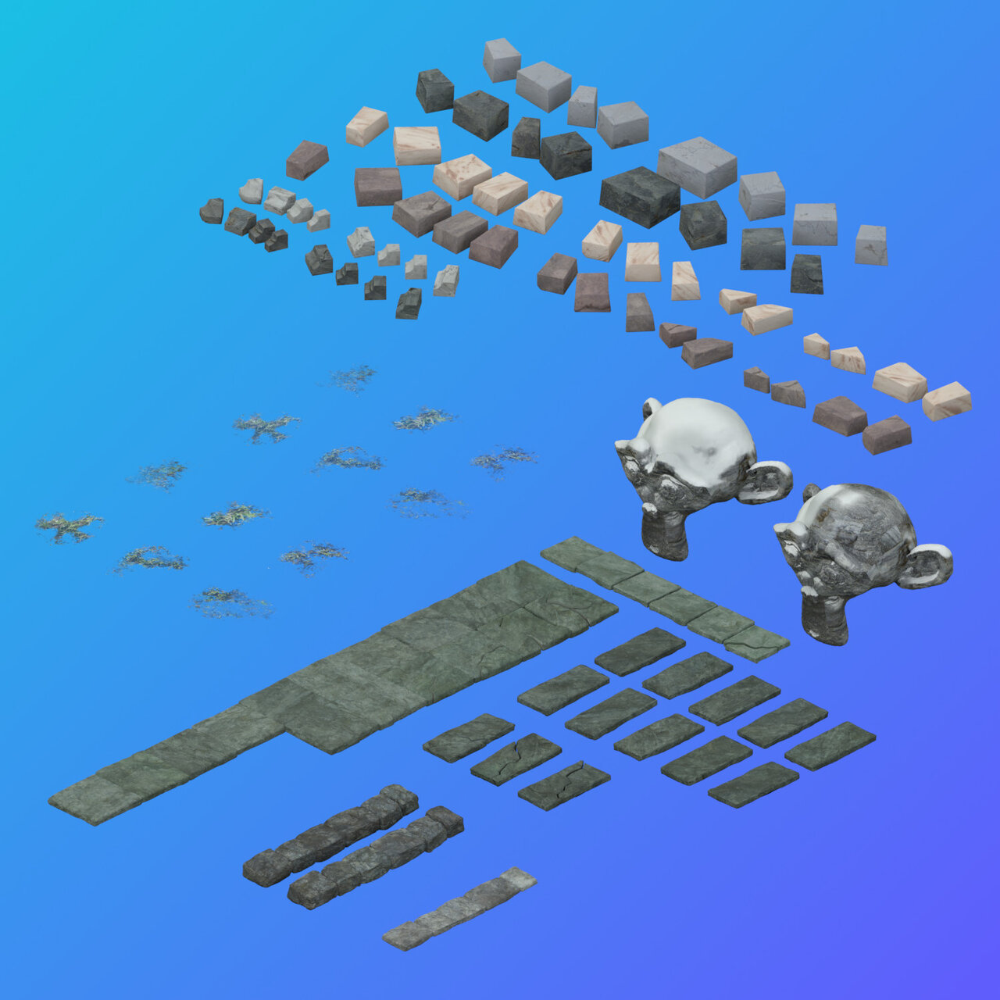
- 파일: `isometric-render-resource-pack.zip` — 릴리스 v8.3 첨부, 48.6MB plain split 4조각
- 제작: rubberduck / 라이선스: CC0 / 원본: https://opengameart.org/content/isometric-render-resource-pack

### Marble Pack
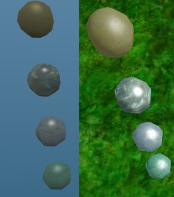
- 파일: `marble-pack.zip` — 릴리스 v8.3 첨부, 단일
- 제작: rubberduck / 라이선스: CC0 / 원본: https://opengameart.org/content/marble-pack

### modular fence pack
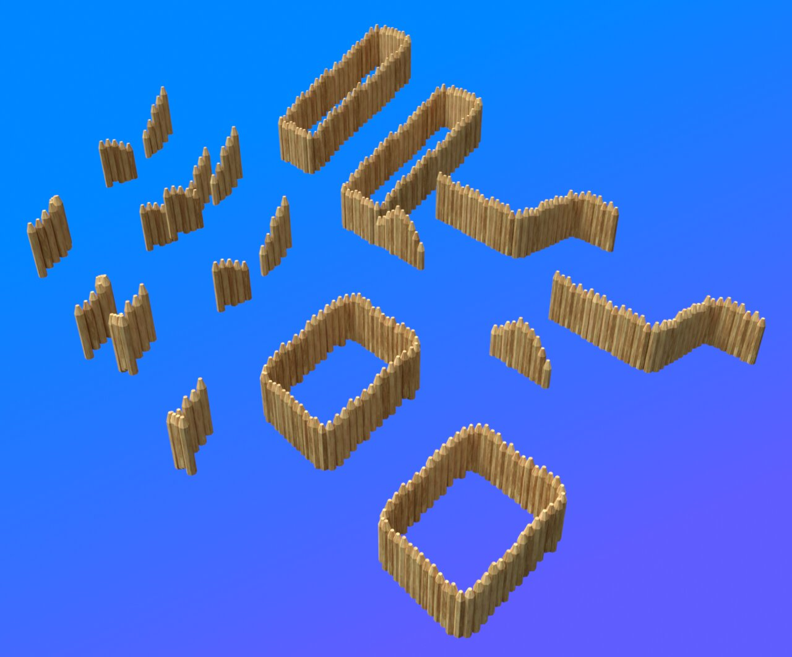
- 파일: `modular-fence-pack.zip` — 릴리스 v8.3 첨부, 단일
- 제작: rubberduck / 라이선스: CC0 / 원본: https://opengameart.org/content/modular-fence-pack

### modular grassland 3D tileset
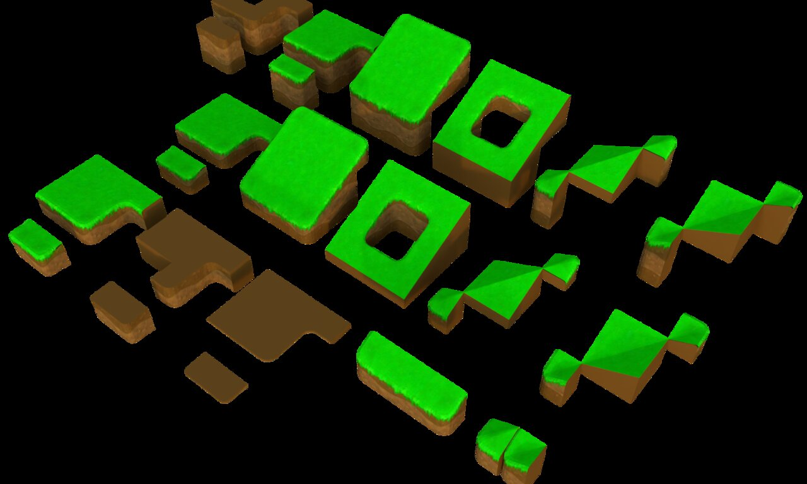
- 파일: `modular-grassland-3d-tileset.zip` — 릴리스 v8.3 첨부, 32MB plain split 3조각
- 제작: rubberduck / 라이선스: CC0 / 원본: https://opengameart.org/content/modular-grassland-3d-tileset

### more handpainted rocks
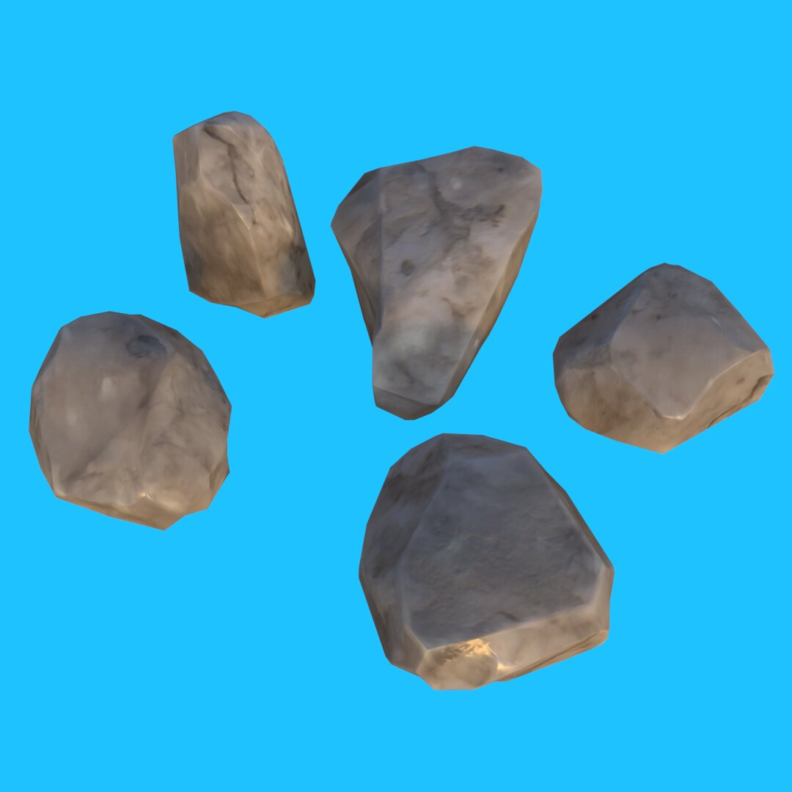
- 파일: `more-handpainted-rocks.zip` — 릴리스 v8.3 첨부, 34.4MB plain split 3조각
- 제작: rubberduck / 라이선스: CC0 / 원본: https://opengameart.org/content/more-handpainted-rocks

## 2026-10-28 추가 팩 6차 (릴리스 v8.4)

모두 rubberduck (OpenGameArt) CC0 3D 팩. **주의: 이 릴리스의 `3d-castle-dungeon-tileset-extended`, `free-3d-castle-dungeon-tileset`, `robot-character` 3개 자산은 1차(릴리스 v7.0) 수집분과 동일한 사본입니다. 링크 보존을 위해 릴리스에 남겨두지만 고유 팩 수 집계에서는 제외합니다. 신규 고유 팩은 아래 4개입니다.**

### rubberduck
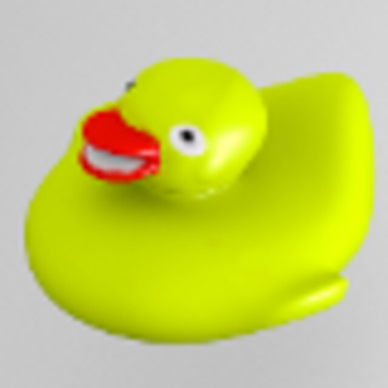
- 파일: `rubberduck.zip` — 릴리스 v8.4 첨부, 단일
- 제작: rubberduck / 라이선스: CC0 / 원본: https://opengameart.org/content/rubberduck

### Sci-Fi container
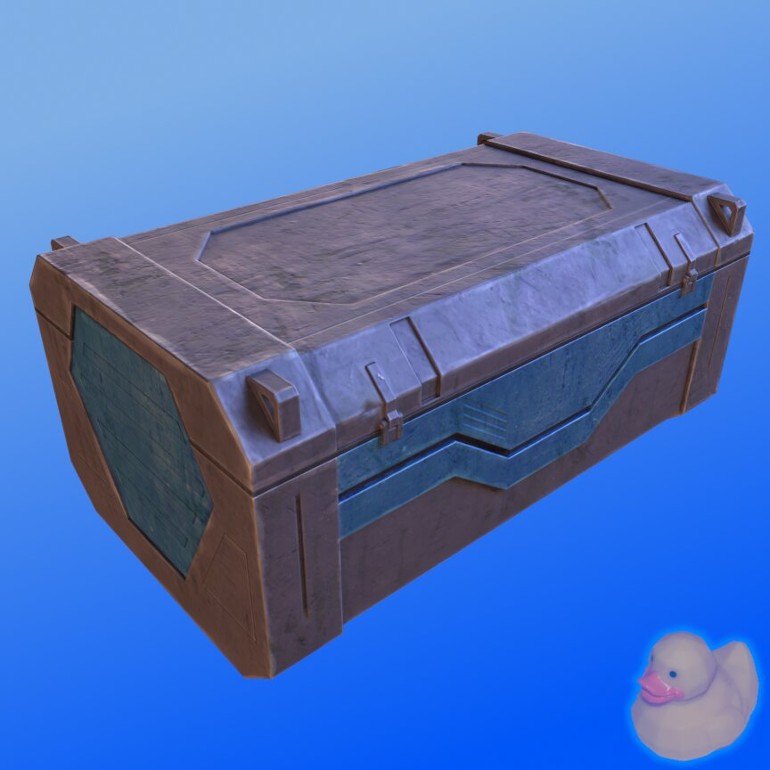
- 파일: `sci-fi-container.zip` (원본 3개 아카이브 병합: container_highpoly.blend.zip, container_textures_high_res.zip, sci-fi_container_01.zip — 각 하위폴더로 보존) — 릴리스 v8.4 첨부, 129MB plain split 9조각
- 제작: rubberduck / 라이선스: CC0 / 원본: https://opengameart.org/content/sci-fi-container

### shadow twins asset pack
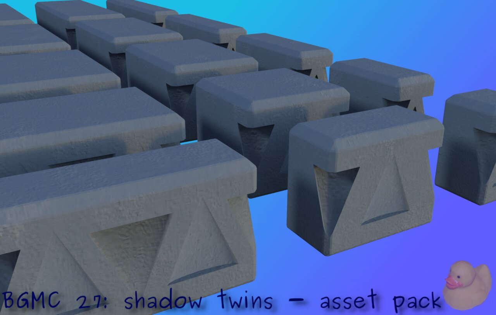
- 파일: `shadow-twins-asset-pack.zip` (BLEND 1개; bare blend를 zip으로 재압축) — 릴리스 v8.4 첨부, 단일
- 제작: rubberduck / 라이선스: CC0 / 원본: https://opengameart.org/content/shadow-twins-asset-pack

### simple 3d crystals (unwrapped, simple texture)
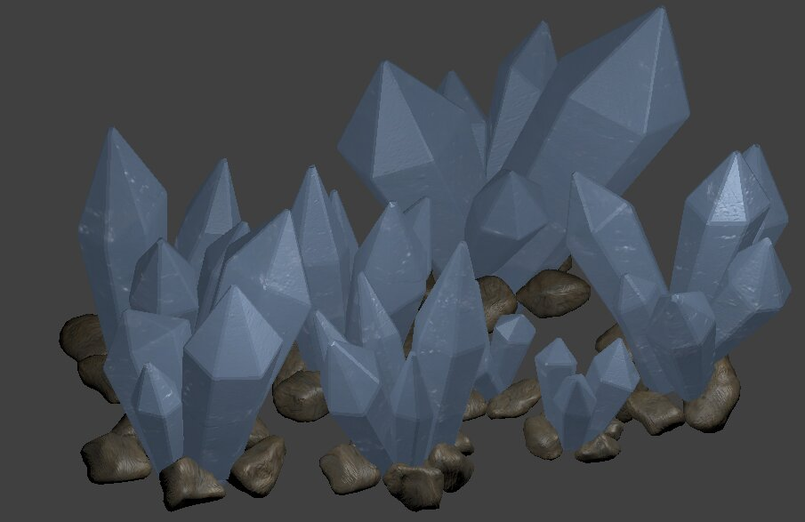
- 파일: `simple-3d-crystals-unwrapped-simple-texture.zip` — 릴리스 v8.4 첨부, 단일
- 제작: rubberduck / 라이선스: CC0 / 원본: https://opengameart.org/content/simple-3d-crystals-unwrapped-simple-texture

## 2026-10-28 추가 팩 7차 (릴리스 v8.5)

모두 rubberduck (OpenGameArt) CC0 3D 팩. 원본 배포본에 라이선스 파일이 없어 수집자 작성 LICENSE-SOURCE.txt를 동봉했습니다. 분할 팩 재결합: `cat <팩명>.zip.part* > <팩명>.zip` (Windows: `copy /b part01+part02+... <팩명>.zip`).

### Mossy Rock Environment Pack
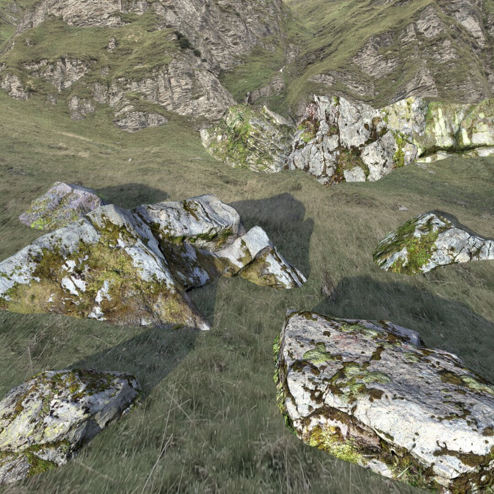
- 파일: `mossy-rock-environment-pack.zip` — 릴리스 v8.5 첨부, 237MB plain split 16조각
- 제작: rubberduck / 라이선스: CC0 / 원본: https://opengameart.org/content/mossy-rock-environment-pack

### Stylized Boxes
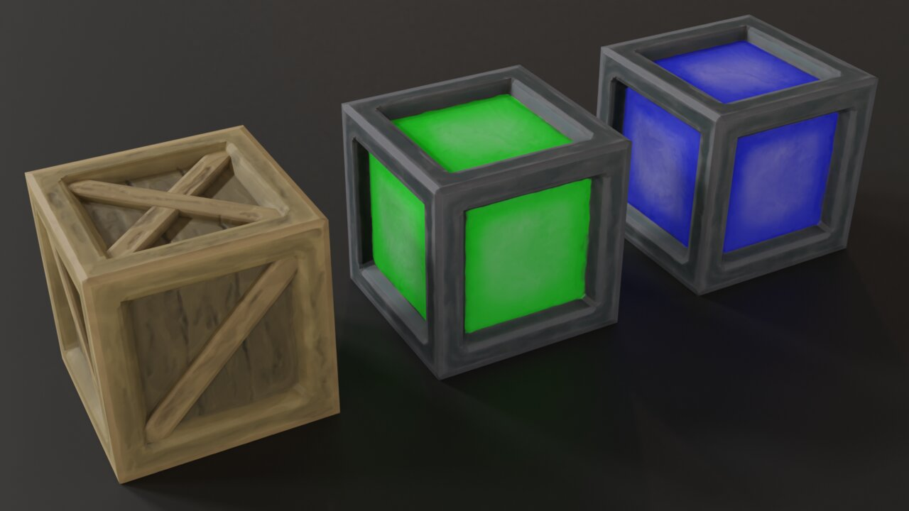
- 파일: `stylized-boxes.zip` — 릴리스 v8.5 첨부, 66.6MB plain split 5조각
- 제작: rubberduck / 라이선스: CC0 / 원본: https://opengameart.org/content/stylized-boxes

### Stylized Hand-Painted Stone Blocks

- 파일: `stylized-hand-painted-stone-blocks.zip` — 릴리스 v8.5 첨부, 62.8MB plain split 4조각
- 제작: rubberduck / 라이선스: CC0 / 원본: https://opengameart.org/content/stylized-hand-painted-stone-blocks

### Voxel Low Poly Hybrid Cave Pack

- 파일: `voxel-low-poly-hybrid-cave-pack.zip` — 릴리스 v8.5 첨부, 단일
- 제작: rubberduck / 라이선스: CC0 / 원본: https://opengameart.org/content/voxel-low-poly-hybrid-cave-pack
## 2026-10-29 추가 팩 8차 (릴리스 v8.6)

모두 rubberduck (OpenGameArt) 3D 팩, 이번 배치는 CC-BY 계열이라 사용 시 저작자 표기가 필요합니다. 각 팩의 LICENSE-SOURCE.txt(수집자 작성)에 원본 저작자·정확한 CC 버전·출처·변경 내역과 원본 아카이브/파일 SHA-256이 기록되어 있습니다. 분할 팩 재결합: `cat <팩명>.zip.part* > <팩명>.zip` (Windows: `copy /b part01+part02+... <팩명>.zip`).

### cmvalley lamps reworked

- 파일: `cmvalley-lamps-reworked.zip` — 릴리스 v8.6 첨부, 23.7MB plain split 2조각
- 제작: rubberduck / 라이선스: CC-BY 4.0 (귀속: rubberduck) / 원본: https://opengameart.org/content/cmvalley-lamps-reworked
- 내용: cmvalley godot 데모 맵 램프 리워크. 5종 램프 + 경량 변형 (obj/mtl/blend + PBR 텍스처 12종)

### Franck (Cosmos Laundromat) animated game character

- 파일: `franck-cosmos-laundromat-animated-game-character.zip` — 릴리스 v8.6 첨부, 단일
- 제작: rubberduck / 라이선스: CC-BY 3.0 (귀속: rubberduck; 원본 모델 Blender Institute, "Cosmos Laundromat", CC-BY) / 원본: https://opengameart.org/content/franck-cosmos-laundromat-animated-game-character
- 내용: 오픈 무비의 Franck 양 캐릭터 게임용 버전, 리깅+애니메이션 (blend). 원본 License.txt 동봉

### handpainted rock formations

- 파일: `handpainted-rock-formations.zip` — 릴리스 v8.6 첨부, 단일
- 제작: rubberduck / 라이선스: CC-BY 3.0 (귀속: rubberduck; 원본 OliverMH, BlendSwap 71296, CC-BY 3.0) / 원본: https://opengameart.org/content/handpainted-rock-formations
- 내용: 핸드페인티드 바위 형상. LOD·콜리전 메시, obj/dae, Godot 파일(.tscn·material) 포함. handpainted-style-rocks/more-handpainted-rocks와 바이트 중복 0건의 별개 팩

### Industrial Extension Pack 2 - factory halls

- 파일: `industrial-extension-pack-2-factory-halls.zip` — 릴리스 v8.6 첨부, 단일
- 제작: rubberduck / 라이선스: 모델 CC0 + 텍스처 CC-BY 3.0 (제작자 README 기준; 본 라이브러리는 CC-BY 3.0으로 표기, 귀속: rubberduck; 텍스처 원본 ideasman42/Campbell Barton) / 원본: https://opengameart.org/content/industrial-extension-pack-2-factory-halls
- 내용: 공장 홀 2종(외부 전용/내부 포함 변형), empties로 지붕 경사·벽 높이 조절, 두 번째 홀은 array 모디파이어로 반복 지붕 구조 가능. 텍스처 JPG 28개는 seamless-industrial-textures 팩 파일과 바이트 동일(원저작자가 동일 텍스처 사용; 실제 고유 추가는 BLEND+README)

### stone plate pack

- 파일: `stone-plate-pack.zip` — 릴리스 v8.6 첨부, 66.9MB plain split 5조각
- 제작: rubberduck / 라이선스: CC-BY 4.0 (귀속: rubberduck) / 원본: https://opengameart.org/content/stone-plate-pack
- 내용: 조각한 돌판 6종(1x1·1x2·2x2 각 2개). 고폴리 plates_high.blend 포함(리텍스처용). 원본이 별도 blend 2개로 배포되어 수집자가 zip으로 묶음

### Downtown City MegaKit

- 파일: `downtown-city-megakit.zip` — 릴리스 v8.8 첨부, 224MB plain split 15조각 (`cat downtown-city-megakit.zip.part* > downtown-city-megakit.zip`)
- 제작: Quaternius / 라이선스: CC0 / 원본: https://quaternius.com/packs/downtowncitymegakit.html (itch.io Standard 무료 버전 원본 바이트)
- 내용: 도심 모듈 건물·도로 153종 glTF·FBX + PNG·HDR. zip에 원본 License_Standard.txt(CC0) 포함

### Modular Character Outfits - Fantasy

- 파일: `modular-character-outfits-fantasy.zip` — 릴리스 v8.8 첨부, 280MB plain split 19조각
- 제작: Quaternius / 라이선스: CC0 / 원본: https://quaternius.com/packs/modularcharacteroutfitsfantasy.html (itch.io Standard 무료 버전 원본 바이트)
- 내용: 판타지 의상 24종 glTF·FBX + PNG 46. Universal Base Characters와 결합 사용(zip 내 Readme). zip에 원본 License_Standard.txt(CC0) 포함

### Universal Base Characters

- 파일: `universal-base-characters.zip` — 릴리스 v8.8 첨부, 123MB plain split 9조각
- 제작: Quaternius / 라이선스: CC0 / 원본: https://quaternius.com/packs/universalbasecharacters.html (itch.io Standard 무료 버전 원본 바이트)
- 내용: 베이스 캐릭터 10종 glTF·FBX + PNG 48. Modular Character Outfits와 호환. zip에 원본 License_Standard.txt(CC0) 포함

### Ultimate Platformer Pack

- 파일: `ultimate-platformer-pack.zip` — 릴리스 v8.7 첨부, 18MB plain split 2조각
- 제작: Quaternius / 라이선스: CC0 / 원본: https://quaternius.com/packs/ultimateplatformer.html (페이지명 Platformer Game Kit; itch.io 업로드명 Ultimate Platformer Pack 원본 바이트)
- 내용: 플랫포머 모듈 110종 glTF·OBJ·FBX·BLEND. zip에 원본 License.txt(CC0) 포함. Modular Platformer Pack과 이름 유사 모델 일부 관련, 내용은 별개 버전

### 3D Card Kit - Fantasy

- 파일: `3d-card-kit-fantasy.zip` — 릴리스 v8.7 첨부, 46MB plain split 4조각
- 제작: Quaternius / 라이선스: CC0 / 원본: https://quaternius.com/packs/3dcardkitfantasy.html (itch.io Standard 무료 버전 원본 바이트)
- 내용: 판타지 카드 모델 34종 glTF·OBJ·FBX + PNG 34. zip에 원본 License.txt(CC0) 포함

### Modular Platformer Pack

- 파일: `modular-platformer-pack.zip` — 릴리스 v8.7 첨부, 단일
- 제작: Quaternius / 라이선스: CC0 / 원본: https://quaternius.com/packs/modularplatformer.html (itch.io 업로드명 Platformer Pack by Quaternius)
- 내용: 플랫포머 모듈·트랩 53종 OBJ·FBX·BLEND. 원본 zip에 라이선스 미동봉 → LICENSE-SOURCE.txt(수집자 작성) 동봉

### Easy Enemy Pack

- 파일: `easy-enemy-pack.zip` — 릴리스 v8.7 첨부, 단일
- 제작: Quaternius / 라이선스: CC0 / 원본: https://quaternius.com/packs/easyenemy.html (itch.io 업로드명 Easy Animated Enemy Pack - Jan 2019)
- 내용: 적 캐릭터 6종 OBJ·FBX·BLEND. 원본 zip에 라이선스 미동봉 → LICENSE-SOURCE.txt(수집자 작성) 동봉

### Farm Buildings Pack

- 파일: `farm-buildings-pack.zip` — 릴리스 v8.7 첨부, 단일
- 제작: Quaternius / 라이선스: CC0 / 원본: https://quaternius.com/packs/farmbuildings.html (itch.io 업로드명 Farm Buildings by Quaternius)
- 내용: 농장 건물 13종 OBJ·FBX·BLEND. 원본 zip에 라이선스 미동봉 → LICENSE-SOURCE.txt(수집자 작성) 동봉

## v8.9 — Quaternius 3D 팩 16종 (OpenGameArt 미러, 2026-10-29)

Drive 익명 다운로드 쿼터 차단에 따른 검증 대체 경로(OpenGameArt 원본 페이지)로 수집. ultimate-food-pack은 v5.0 Low Poly Food Pack과 바이트 동일(309/309 파일)하여 제외.

### Ultimate Animated Character Pack

- 파일: `ultimate-animated-character-pack.zip` — 릴리스 v8.9 첨부, 4개 part 분할(`cat ultimate-animated-character-pack.zip.part* > ultimate-animated-character-pack.zip`)
- 제작: Quaternius / 라이선스: CC0 / 원본: https://opengameart.org/content/animated-characters-pack
- 내용: 모델 52종 × OBJ·FBX·BLEND; OGA 미러 수집(Drive 쿼터 차단 대체); 원본 라이선스 미포함 → 수집자 작성 LICENSE-SOURCE.txt 동봉(출처·CC0 명기)

### Ultimate RPG Pack

- 파일: `ultimate-rpg-pack.zip` — 릴리스 v8.9 첨부, 3개 part 분할(`cat ultimate-rpg-pack.zip.part* > ultimate-rpg-pack.zip`)
- 제작: Quaternius / 라이선스: CC0 / 원본: https://opengameart.org/content/low-poly-rpg-pack
- 내용: 모델 106종 + 아이콘 PNG 107 × OBJ·FBX·BLEND; OGA 미러 수집(Drive 쿼터 차단 대체); zip에 원본 License.txt(CC0) 포함, 원본 바이트 그대로

### Ultimate Textured Buildings Pack

- 파일: `ultimate-textured-buildings-pack.zip` — 릴리스 v8.9 첨부, 3개 part 분할(`cat ultimate-textured-buildings-pack.zip.part* > ultimate-textured-buildings-pack.zip`)
- 제작: Quaternius / 라이선스: CC0 / 원본: https://opengameart.org/content/lowpoly-buildings-pack
- 내용: 모델 102종 × OBJ·FBX·BLEND; OGA 미러 수집(Drive 쿼터 차단 대체); 원본 라이선스 미포함 → 수집자 작성 LICENSE-SOURCE.txt 동봉(출처·CC0 명기)

### Ultimate Furniture Pack

- 파일: `ultimate-furniture-pack.zip` — 릴리스 v8.9 첨부, 단일
- 제작: Quaternius / 라이선스: CC0 / 원본: https://opengameart.org/content/furniture-low-poly
- 내용: 모델 23종 × OBJ·FBX·BLEND; OGA 미러 수집(Drive 쿼터 차단 대체); 원본 라이선스 미포함 → 수집자 작성 LICENSE-SOURCE.txt 동봉(출처·CC0 명기)

### Modular Medieval Buildings Pack

- 파일: `modular-medieval-buildings-pack.zip` — 릴리스 v8.9 첨부, 단일
- 제작: Quaternius / 라이선스: CC0 / 원본: https://opengameart.org/content/lowpoly-medieval-buildings
- 내용: 모델 30종 × OBJ·FBX·BLEND; OGA 미러 수집(Drive 쿼터 차단 대체); 원본 라이선스 미포함 → 수집자 작성 LICENSE-SOURCE.txt 동봉(출처·CC0 명기); Medieval Village MegaKit(v6.0)과 다른 팩(공통 모델명 0)

### Modular Dungeon Pack

- 파일: `modular-dungeon-pack.zip` — 릴리스 v8.9 첨부, 단일
- 제작: Quaternius / 라이선스: CC0 / 원본: https://opengameart.org/content/lowpoly-modular-dungeon
- 내용: 모델 40종 × OBJ·FBX·BLEND; OGA 미러 수집(Drive 쿼터 차단 대체); 원본 라이선스 미포함 → 수집자 작성 LICENSE-SOURCE.txt 동봉(출처·CC0 명기); v5.0 LowPoly Modular Dungeon Pack(48종)과 다른 버전(공통명 12종이나 바이트 상이)

### Survival Pack

- 파일: `survival-pack.zip` — 릴리스 v8.9 첨부, 단일
- 제작: Quaternius / 라이선스: CC0 / 원본: https://opengameart.org/content/lowpoly-survival-pack
- 내용: 모델 53종 × OBJ·FBX·BLEND; OGA 미러 수집(Drive 쿼터 차단 대체); zip에 원본 License.txt(CC0) 포함, 원본 바이트 그대로

### Pirate Kit

- 파일: `pirate-kit.zip` — 릴리스 v8.9 첨부, 단일
- 제작: Quaternius / 라이선스: CC0 / 원본: https://opengameart.org/content/low-poly-pirate-pack
- 내용: 모델 8종 × OBJ·FBX·BLEND; OGA 미러 수집(Drive 쿼터 차단 대체); 원본 라이선스 미포함 → 수집자 작성 LICENSE-SOURCE.txt 동봉(출처·CC0 명기)

### RPG Essentials Pack

- 파일: `rpg-essentials-pack.zip` — 릴리스 v8.9 첨부, 단일
- 제작: Quaternius / 라이선스: CC0 / 원본: https://opengameart.org/content/lowpoly-rpg
- 내용: 모델 13종 × OBJ·FBX·BLEND; OGA 미러 수집(Drive 쿼터 차단 대체); 원본 라이선스 미포함 → 수집자 작성 LICENSE-SOURCE.txt 동봉(출처·CC0 명기)

### Buildings Pack

- 파일: `buildings-pack.zip` — 릴리스 v8.9 첨부, 단일
- 제작: Quaternius / 라이선스: CC0 / 원본: https://opengameart.org/content/lowpoly-buildings
- 내용: 모델 10종 × OBJ·FBX·BLEND; OGA 미러 수집(Drive 쿼터 차단 대체); 원본 라이선스 미포함 → 수집자 작성 LICENSE-SOURCE.txt 동봉(출처·CC0 명기)

### Simple Nature Pack

- 파일: `simple-nature-pack.zip` — 릴리스 v8.9 첨부, 단일
- 제작: Quaternius / 라이선스: CC0 / 원본: https://opengameart.org/content/lowpoly-nature-pack
- 내용: 모델 13종 × OBJ·FBX·BLEND; OGA 미러 수집(Drive 쿼터 차단 대체); 원본 라이선스 미포함 → 수집자 작성 LICENSE-SOURCE.txt 동봉(출처·CC0 명기); v5.0 Low Poly Nature Pack 및 Stylized Nature MegaKit과 공통 모델명 0

### Textured Fantasy Nature Pack

- 파일: `textured-fantasy-nature-pack.zip` — 릴리스 v8.9 첨부, 단일
- 제작: Quaternius / 라이선스: CC0 / 원본: https://opengameart.org/content/fantasy-low-poly-trees-and-bushes
- 내용: 모델 11종 + 텍스처 PNG 12 × OBJ·FBX·BLEND; OGA 미러 수집(Drive 쿼터 차단 대체); 원본 라이선스 미포함 → 수집자 작성 LICENSE-SOURCE.txt 동봉(출처·CC0 명기); v5.0 LowPoly Textured Trees와 공통 모델명 0

### Animated Guns Pack

- 파일: `animated-guns-pack.zip` — 릴리스 v8.9 첨부, 단일
- 제작: Quaternius / 라이선스: CC0 / 원본: https://opengameart.org/content/low-poly-animated-guns
- 내용: 모델 6종 × OBJ·FBX·BLEND; OGA 미러 수집(Drive 쿼터 차단 대체); 원본 라이선스 미포함 → 수집자 작성 LICENSE-SOURCE.txt 동봉(출처·CC0 명기)

### Animated Human

- 파일: `animated-human.zip` — 릴리스 v8.9 첨부, 단일
- 제작: Quaternius / 라이선스: CC0 / 원본: https://opengameart.org/content/animated-human-low-poly
- 내용: 애니메이션 인체 1종 + 스킨 텍스처 8 × OBJ·FBX·DAE·BLEND; OGA 미러 수집(Drive 쿼터 차단 대체); zip에 원본 License.txt(CC0) 포함, 원본 바이트 그대로

### GunPack Vol.1

- 파일: `gunpack-vol1.zip` — 릴리스 v8.9 첨부, 단일
- 제작: Quaternius / 라이선스: CC0 / 원본: https://opengameart.org/content/low-poly-guns
- 내용: 모델 5종 × OBJ·BLEND; OGA 미러 수집(Drive 쿼터 차단 대체); 원본 라이선스 미포함 → 수집자 작성 LICENSE-SOURCE.txt 동봉(출처·CC0 명기); v5.0 Low Poly Guns Pack(55종)과 공통 모델명 0

### Furniture Pack Vol.2

- 파일: `furniture-pack-vol2.zip` — 릴리스 v8.9 첨부, 단일
- 제작: Quaternius / 라이선스: CC0 / 원본: https://opengameart.org/content/low-poly-furniture-1
- 내용: 모델 8종 × OBJ·BLEND; OGA 미러 수집(Drive 쿼터 차단 대체); 원본 라이선스 미포함 → 수집자 작성 LICENSE-SOURCE.txt 동봉(출처·CC0 명기); Ultimate Furniture Pack과 3종 이름만 겹침(바이트 상이), 5종 고유

## v8.10 — Kenney 3D 킷 31종 (kenney.nl 공식, 2026-10-29)

Kenney 공식 사이트 전수 대조로 수집한 신규 3D 킷 31종. 전부 CC0, zip에 원본 License.txt 포함, 원본 바이트 그대로. 원격 SHA-256 검증 31/31 완료.

### Animated Characters Protagonists

- 파일: `animated-characters-protagonists.zip` — 릴리스 v8.10 첨부, 단일
- 제작: Kenney / 라이선스: CC0 / 원본: https://kenney.nl/assets/animated-characters-protagonists
- 내용: 모델 4종(glTF·OBJ·FBX 등) + PNG 5; zip에 원본 License.txt(CC0) 포함; 원본 바이트 그대로

### Animated Characters Retro

- 파일: `animated-characters-retro.zip` — 릴리스 v8.10 첨부, 단일
- 제작: Kenney / 라이선스: CC0 / 원본: https://kenney.nl/assets/animated-characters-retro
- 내용: 모델 4종(glTF·OBJ·FBX 등) + PNG 5; zip에 원본 License.txt(CC0) 포함; 원본 바이트 그대로

### Animated Characters Survivors

- 파일: `animated-characters-survivors.zip` — 릴리스 v8.10 첨부, 단일
- 제작: Kenney / 라이선스: CC0 / 원본: https://kenney.nl/assets/animated-characters-survivors
- 내용: 모델 4종(glTF·OBJ·FBX 등) + PNG 6; zip에 원본 License.txt(CC0) 포함; 원본 바이트 그대로

### Blaster Kit

- 파일: `blaster-kit.zip` — 릴리스 v8.10 첨부, 단일
- 제작: Kenney / 라이선스: CC0 / 원본: https://kenney.nl/assets/blaster-kit
- 내용: 모델 120종(glTF·OBJ·FBX 등) + PNG 46; zip에 원본 License.txt(CC0) 포함; 원본 바이트 그대로

### Brick Kit

- 파일: `brick-kit.zip` — 릴리스 v8.10 첨부, 단일
- 제작: Kenney / 라이선스: CC0 / 원본: https://kenney.nl/assets/brick-kit
- 내용: 모델 888종(glTF·OBJ·FBX 등) + PNG 301; zip에 원본 License.txt(CC0) 포함; 원본 바이트 그대로

### Building Kit

- 파일: `building-kit.zip` — 릴리스 v8.10 첨부, 단일
- 제작: Kenney / 라이선스: CC0 / 원본: https://kenney.nl/assets/building-kit
- 내용: 모델 237종(glTF·OBJ·FBX 등) + PNG 86; zip에 원본 License.txt(CC0) 포함; 원본 바이트 그대로

### City Kit (Commercial)

- 파일: `city-kit-commercial.zip` — 릴리스 v8.10 첨부, 단일
- 제작: Kenney / 라이선스: CC0 / 원본: https://kenney.nl/assets/city-kit-commercial
- 내용: 모델 123종(glTF·OBJ·FBX 등) + PNG 50; zip에 원본 License.txt(CC0) 포함; 원본 바이트 그대로

### City Kit (Industrial)

- 파일: `city-kit-industrial.zip` — 릴리스 v8.10 첨부, 단일
- 제작: Kenney / 라이선스: CC0 / 원본: https://kenney.nl/assets/city-kit-industrial
- 내용: 모델 111종(glTF·OBJ·FBX 등) + PNG 48; zip에 원본 License.txt(CC0) 포함; 원본 바이트 그대로

### City Kit (Roads)

- 파일: `city-kit-roads.zip` — 릴리스 v8.10 첨부, 단일
- 제작: Kenney / 라이선스: CC0 / 원본: https://kenney.nl/assets/city-kit-roads
- 내용: 모델 285종(glTF·OBJ·FBX 등) + PNG 102; zip에 원본 License.txt(CC0) 포함; 원본 바이트 그대로

### City Kit (Suburban)

- 파일: `city-kit-suburban.zip` — 릴리스 v8.10 첨부, 단일
- 제작: Kenney / 라이선스: CC0 / 원본: https://kenney.nl/assets/city-kit-suburban
- 내용: 모델 120종(glTF·OBJ·FBX 등) + PNG 51; zip에 원본 License.txt(CC0) 포함; 원본 바이트 그대로

### Coaster Kit

- 파일: `coaster-kit.zip` — 릴리스 v8.10 첨부, 단일
- 제작: Kenney / 라이선스: CC0 / 원본: https://kenney.nl/assets/coaster-kit
- 내용: 모델 549종(glTF·OBJ·FBX 등) + PNG 193; zip에 원본 License.txt(CC0) 포함; 원본 바이트 그대로

### Cube Pets

- 파일: `cube-pets.zip` — 릴리스 v8.10 첨부, 단일
- 제작: Kenney / 라이선스: CC0 / 원본: https://kenney.nl/assets/cube-pets
- 내용: 모델 72종(glTF·OBJ·FBX 등) + PNG 28; zip에 원본 License.txt(CC0) 포함; 원본 바이트 그대로

### Factory Kit

- 파일: `factory-kit.zip` — 릴리스 v8.10 첨부, 단일
- 제작: Kenney / 라이선스: CC0 / 원본: https://kenney.nl/assets/factory-kit
- 내용: 모델 429종(glTF·OBJ·FBX 등) + PNG 150; zip에 원본 License.txt(CC0) 포함; 원본 바이트 그대로

### Marble Kit

- 파일: `marble-kit.zip` — 릴리스 v8.10 첨부, 단일
- 제작: Kenney / 라이선스: CC0 / 원본: https://kenney.nl/assets/marble-kit
- 내용: 모델 486종(glTF·OBJ·FBX 등) + PNG 173; zip에 원본 License.txt(CC0) 포함; 원본 바이트 그대로

### Mini Arcade

- 파일: `mini-arcade.zip` — 릴리스 v8.10 첨부, 단일
- 제작: Kenney / 라이선스: CC0 / 원본: https://kenney.nl/assets/mini-arcade
- 내용: 모델 60종(glTF·OBJ·FBX 등) + PNG 29; zip에 원본 License.txt(CC0) 포함; 원본 바이트 그대로

### Mini Arena

- 파일: `mini-arena.zip` — 릴리스 v8.10 첨부, 단일
- 제작: Kenney / 라이선스: CC0 / 원본: https://kenney.nl/assets/mini-arena
- 내용: 모델 66종(glTF·OBJ·FBX 등) + PNG 27; zip에 원본 License.txt(CC0) 포함; 원본 바이트 그대로

### Mini Characters

- 파일: `mini-characters.zip` — 릴리스 v8.10 첨부, 단일
- 제작: Kenney / 라이선스: CC0 / 원본: https://kenney.nl/assets/mini-characters
- 내용: 모델 78종(glTF·OBJ·FBX 등) + PNG 30; zip에 원본 License.txt(CC0) 포함; 원본 바이트 그대로

### Mini Dungeon

- 파일: `mini-dungeon.zip` — 릴리스 v8.10 첨부, 단일
- 제작: Kenney / 라이선스: CC0 / 원본: https://kenney.nl/assets/mini-dungeon
- 내용: 모델 90종(glTF·OBJ·FBX 등) + PNG 37; zip에 원본 License.txt(CC0) 포함; 원본 바이트 그대로

### Mini Forest

- 파일: `mini-forest.zip` — 릴리스 v8.10 첨부, 단일
- 제작: Kenney / 라이선스: CC0 / 원본: https://kenney.nl/assets/mini-forest
- 내용: 모델 66종(glTF·OBJ·FBX 등) + PNG 27; zip에 원본 License.txt(CC0) 포함; 원본 바이트 그대로

### Mini Market

- 파일: `mini-market.zip` — 릴리스 v8.10 첨부, 단일
- 제작: Kenney / 라이선스: CC0 / 원본: https://kenney.nl/assets/mini-market
- 내용: 모델 60종(glTF·OBJ·FBX 등) + PNG 29; zip에 원본 License.txt(CC0) 포함; 원본 바이트 그대로

### Mini Skate

- 파일: `mini-skate.zip` — 릴리스 v8.10 첨부, 단일
- 제작: Kenney / 라이선스: CC0 / 원본: https://kenney.nl/assets/mini-skate
- 내용: 모델 126종(glTF·OBJ·FBX 등) + PNG 49; zip에 원본 License.txt(CC0) 포함; 원본 바이트 그대로

### Modular Cave Kit

- 파일: `modular-cave-kit.zip` — 릴리스 v8.10 첨부, 단일
- 제작: Kenney / 라이선스: CC0 / 원본: https://kenney.nl/assets/modular-cave-kit
- 내용: 모델 120종(glTF·OBJ·FBX 등) + PNG 49; zip에 원본 License.txt(CC0) 포함; 원본 바이트 그대로

### Modular Dungeon Kit

- 파일: `modular-dungeon-kit.zip` — 릴리스 v8.10 첨부, 단일
- 제작: Kenney / 라이선스: CC0 / 원본: https://kenney.nl/assets/modular-dungeon-kit
- 내용: 모델 117종(glTF·OBJ·FBX 등) + PNG 48; zip에 원본 License.txt(CC0) 포함; 원본 바이트 그대로

### Modular Space Kit

- 파일: `modular-space-kit.zip` — 릴리스 v8.10 첨부, 단일
- 제작: Kenney / 라이선스: CC0 / 원본: https://kenney.nl/assets/modular-space-kit
- 내용: 모델 120종(glTF·OBJ·FBX 등) + PNG 49; zip에 원본 License.txt(CC0) 포함; 원본 바이트 그대로

### Prototype Kit

- 파일: `prototype-kit.zip` — 릴리스 v8.10 첨부, 단일
- 제작: Kenney / 라이선스: CC0 / 원본: https://kenney.nl/assets/prototype-kit
- 내용: 모델 435종(glTF·OBJ·FBX 등) + PNG 155; zip에 원본 License.txt(CC0) 포함; 원본 바이트 그대로

### Retro Fantasy Kit

- 파일: `retro-fantasy-kit.zip` — 릴리스 v8.10 첨부, 단일
- 제작: Kenney / 라이선스: CC0 / 원본: https://kenney.nl/assets/retro-fantasy-kit
- 내용: 모델 315종(glTF·OBJ·FBX 등) + PNG 137; zip에 원본 License.txt(CC0) 포함; 원본 바이트 그대로

### Retro Urban Kit

- 파일: `retro-urban-kit.zip` — 릴리스 v8.10 첨부, 단일
- 제작: Kenney / 라이선스: CC0 / 원본: https://kenney.nl/assets/retro-urban-kit
- 내용: 모델 372종(glTF·OBJ·FBX 등) + PNG 192; zip에 원본 License.txt(CC0) 포함; 원본 바이트 그대로

### Space Station Kit

- 파일: `space-station-kit.zip` — 릴리스 v8.10 첨부, 단일
- 제작: Kenney / 라이선스: CC0 / 원본: https://kenney.nl/assets/space-station-kit
- 내용: 모델 291종(glTF·OBJ·FBX 등) + PNG 104; zip에 원본 License.txt(CC0) 포함; 원본 바이트 그대로

### Survival Kit

- 파일: `survival-kit.zip` — 릴리스 v8.10 첨부, 단일
- 제작: Kenney / 라이선스: CC0 / 원본: https://kenney.nl/assets/survival-kit
- 내용: 모델 240종(glTF·OBJ·FBX 등) + PNG 87; zip에 원본 License.txt(CC0) 포함; 원본 바이트 그대로

### Toy Car Kit

- 파일: `toy-car-kit.zip` — 릴리스 v8.10 첨부, 단일
- 제작: Kenney / 라이선스: CC0 / 원본: https://kenney.nl/assets/toy-car-kit
- 내용: 모델 471종(glTF·OBJ·FBX 등) + PNG 171; zip에 원본 License.txt(CC0) 포함; 원본 바이트 그대로

### Train Kit

- 파일: `train-kit.zip` — 릴리스 v8.10 첨부, 단일
- 제작: Kenney / 라이선스: CC0 / 원본: https://kenney.nl/assets/train-kit
- 내용: 모델 309종(glTF·OBJ·FBX 등) + PNG 110; zip에 원본 License.txt(CC0) 포함; 원본 바이트 그대로

## v8.12 — Quaternius 3D 팩 4종 (OpenGameArt 미러 2차, 2026-10-29)

Drive 익명 다운로드 쿼터 차단에 따른 검증 대체 경로(OpenGameArt) 2차 수집. 전부 CC0, 원본 라이선스 미포함 → 수집자 작성 LICENSE-SOURCE.txt 동봉. Cute Animated Monsters(OGA)는 v4.0 Cute Monsters와 동일 팩의 다른 포맷으로 확인되어 신규 게시하지 않음. CC-BY-SA 3종은 정책상 제외.

### Low Poly Animals Pack

- 파일: `low-poly-animals-pack.zip` — 릴리스 v8.12 첨부, 단일
- 제작: Quaternius / 라이선스: CC0 / 원본: https://opengameart.org/content/5-low-poly-animals
- 내용: 모델 5종 × BLEND·FBX·OBJ + PNG; OGA 미러 수집(Drive 쿼터 차단 대체); 원본 라이선스 미포함 → 수집자 작성 LICENSE-SOURCE.txt 동봉(출처·CC0·원본 SHA-256 명기)

### Animal Pack Vol.2

- 파일: `animal-pack-vol2.zip` — 릴리스 v8.12 첨부, 단일
- 제작: Quaternius / 라이선스: CC0 / 원본: https://opengameart.org/content/animated-animales-low-poly
- 내용: 모델 5종 × BLEND·FBX·OBJ + PNG; OGA 미러 수집(Drive 쿼터 차단 대체); 원본 라이선스 미포함 → 수집자 작성 LICENSE-SOURCE.txt 동봉(출처·CC0·원본 SHA-256 명기)

### Low Poly Space Assets

- 파일: `low-poly-space-assets.zip` — 릴리스 v8.12 첨부, 단일
- 제작: Quaternius / 라이선스: CC0 / 원본: https://opengameart.org/content/low-poly-space-assets
- 내용: 모델 13종 × BLEND·OBJ + PNG 3; OGA 미러 수집(Drive 쿼터 차단 대체); 원본 라이선스 미포함 → 수집자 작성 LICENSE-SOURCE.txt 동봉(출처·CC0·원본 SHA-256 명기); v4.0 Spaceships와 바이트 공통 0의 별개 팩

### Ultimate Space Kit

- 파일: `ultimate-space-kit.zip` — 릴리스 v8.12 첨부, 단일
- 제작: Quaternius / 라이선스: CC0 / 원본: https://opengameart.org/content/ultimate-space-kit-by-quaternius
- 내용: 모델 87종 × GLB; OGA 사용자 재업로드 미러(공식 Drive 쿼터 차단 대체), CC0 명시 페이지; 원본 라이선스 미포함 → 수집자 작성 LICENSE-SOURCE.txt 동봉(출처·CC0·원본 SHA-256 명기)
## v8.13 — Kay Lousberg KayKit 신규 9팩 (itch.io 공식 배포, 2026-10-29)

kaylousberg.itch.io 공식 배포 페이지에서 수집한 CC0 원본. Holiday Bits를 제외한 8팩은 zip에 원본 License.txt(CC0) 포함. Holiday Bits는 원본 라이선스 미동봉 → 수집자 작성 LICENSE-SOURCE.txt 동봉(출처·CC0·원본 SHA-256 명기). itch KayKit Dungeon Pack은 기존 KayKit Dungeon Remastered의 구버전(로스터 207/216 중첩)으로 확인되어 신규 게시하지 않음.

### KayKit Block Bits 1.0

- 파일: `kaykit-block-bits.zip` — 릴리스 v8.13 첨부, 단일
- 제작: Kay Lousberg / 라이선스: CC0 / 원본: https://kaylousberg.itch.io/block-bits
- 내용: 모델 40종 × OBJ·GLB·FBX·BLEND; zip에 원본 License.txt 포함

### KayKit Board Game Bits 1.0

- 파일: `kaykit-board-game-bits.zip` — 릴리스 v8.13 첨부, 15MB 3분할(part01-part03)
- 제작: Kay Lousberg / 라이선스: CC0 / 원본: https://kaylousberg.itch.io/board-game-bits
- 내용: 모델 162종 × OBJ·GLB·FBX·BLEND; zip에 원본 License.txt 포함

### KayKit Fantasy Weapons Bits 1.0

- 파일: `kaykit-fantasy-weapons-bits.zip` — 릴리스 v8.13 첨부, 단일
- 제작: Kay Lousberg / 라이선스: CC0 / 원본: https://kaylousberg.itch.io/fantasy-weapons-bits
- 내용: 모델 31종 × OBJ·GLB·FBX·BLEND; zip에 원본 License.txt 포함

### KayKit Holiday Bits 1.0

- 파일: `kaykit-holiday-bits.zip` — 릴리스 v8.13 첨부, 단일
- 제작: Kay Lousberg / 라이선스: CC0 / 원본: https://kaylousberg.itch.io/holiday-bits
- 내용: 모델 106종 × OBJ·GLB·FBX·BLEND; 원본 라이선스 미동봉 → 수집자 작성 LICENSE-SOURCE.txt 동봉(출처·CC0·원본 SHA-256 명기)

### KayKit Resource Bits 1.0

- 파일: `kaykit-resource-bits.zip` — 릴리스 v8.13 첨부, 단일
- 제작: Kay Lousberg / 라이선스: CC0 / 원본: https://kaylousberg.itch.io/resource-bits
- 내용: 모델 76종 × OBJ·GLB·FBX·BLEND; zip에 원본 License.txt 포함

### KayKit RPG Tools Bits 1.0

- 파일: `kaykit-rpg-tools-bits.zip` — 릴리스 v8.13 첨부, 단일
- 제작: Kay Lousberg / 라이선스: CC0 / 원본: https://kaylousberg.itch.io/rpg-tools-bits
- 내용: 모델 59종 × OBJ·GLB·FBX·BLEND; zip에 원본 License.txt 포함

### KayKit Forest Nature Pack 1.0

- 파일: `kaykit-forest-nature-pack.zip` — 릴리스 v8.13 첨부, 단일
- 제작: Kay Lousberg / 라이선스: CC0 / 원본: https://kaylousberg.itch.io/kaykit-forest
- 내용: 모델 105종 × OBJ·GLB·FBX·BLEND; zip에 원본 License.txt 포함

### KayKit Platformer Pack 1.0

- 파일: `kaykit-platformer-pack.zip` — 릴리스 v8.13 첨부, 15MB 2분할(part01-part02)
- 제작: Kay Lousberg / 라이선스: CC0 / 원본: https://kaylousberg.itch.io/kaykit-platformer
- 내용: 모델 388종 × OBJ·GLB·FBX·BLEND; zip에 원본 License.txt 포함

### KayKit Character Animations 1.1

- 파일: `kaykit-character-animations.zip` — 릴리스 v8.13 첨부, 단일
- 제작: Kay Lousberg / 라이선스: CC0 / 원본: https://kaylousberg.itch.io/kaykit-character-animations
- 내용: 애니메이션 릭 모델 16종 × OBJ·GLB·FBX·BLEND; zip에 원본 License.txt 포함
## v8.14 — konserwa CC0 3D 모델 5종 (OpenGameArt, 2026-10-29)

OpenGameArt 사용자 konserwa의 CC0 모델. 전부 원본 라이선스 미동봉 → 수집자 작성 LICENSE-SOURCE.txt 동봉(출처·CC0·원본 SHA-256 명기). 단일 파일 배포분은 수집자가 zip으로 재포장(내용 바이트 동일).

### Low Poly dude

- 파일: `low-poly-dude.zip` — 릴리스 v8.14 첨부, 단일
- 제작: konserwa / 라이선스: CC0 / 원본: https://opengameart.org/content/low-poly-dude-0
- 내용: FBX 1종 + 텍스처 PNG 3; 원본 zip 그대로 내장

### Anime woman

- 파일: `anime-woman.zip` — 릴리스 v8.14 첨부, 단일
- 제작: konserwa / 라이선스: CC0 / 원본: https://opengameart.org/content/anime-woman
- 내용: BLEND 1종; 수집자 재포장(내용 바이트 동일)

### Lowpoly girl

- 파일: `lowpoly-girl.zip` — 릴리스 v8.14 첨부, 단일
- 제작: konserwa / 라이선스: CC0 / 원본: https://opengameart.org/content/lowpoly-girl
- 내용: BLEND 1종; 수집자 재포장(내용 바이트 동일)

### panzerkampfwagen III

- 파일: `panzerkampfwagen-iii.zip` — 릴리스 v8.14 첨부, 단일
- 제작: konserwa / 라이선스: CC0 / 원본: https://opengameart.org/content/panzerkampfwagen-iii
- 내용: BLEND·3DS 1종씩; 수집자 재포장(내용 바이트 동일)

### penguin

- 파일: `penguin-1.zip` — 릴리스 v8.14 첨부, 단일
- 제작: konserwa / 라이선스: CC0 / 원본: https://opengameart.org/content/penguin-1
- 내용: 원본 7z 그대로 내장
